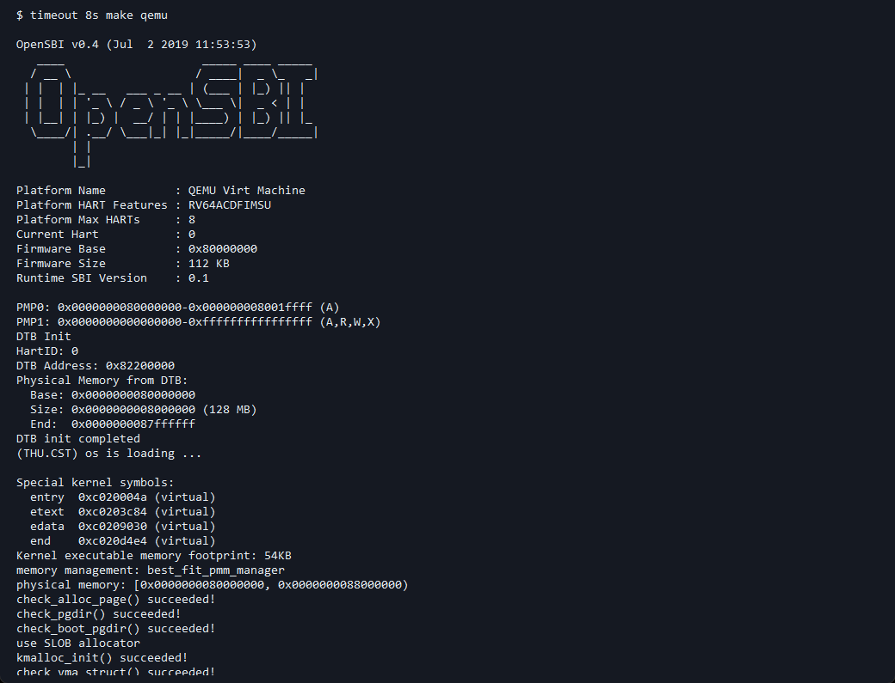
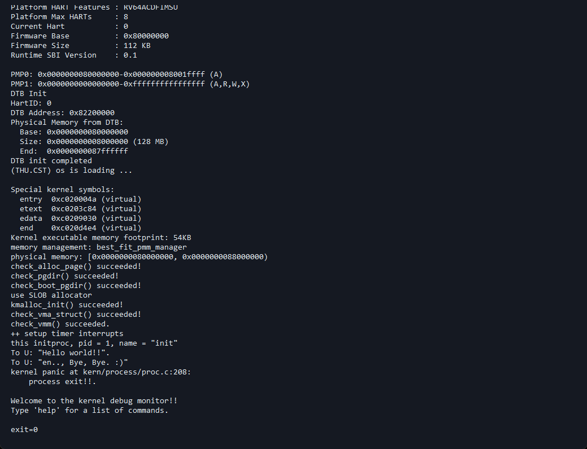

# 操作系统实验报告

## 实验基本信息

| 项目               | 内容                                           |
| ------------------ | ---------------------------------------------- |
| **实验名称** | Lab 4：进程管理                                |
| **小组成员** | 2412950-路浩斌、2411865-王泽浩、2413771-罗裕城 |
| **完成日期** | 2026-11-19                                     |

### 小组分工

| 成员           | 负责的练习/模块                          |
| -------------- | ---------------------------------------- |
| 2412950-路浩斌 | 虚拟内存页操作、分页模式 Challenge       |
| 2411865-王泽浩 | 进程创建及初始化、启动与创建测试整理     |
| 2413771-罗裕城 | 进程调度与上下文切换、中断开关 Challenge |

三位成员各负责一个功能模块及相应报告章节。路浩斌整理页映射和分页模式，王泽浩整理线程创建与启动验证，罗裕城整理调度、中断临界区与自动评分。

---

## 一、实验目的

1. 在已有物理页分配器和 Sv39 页表的基础上，实现映射建立、替换和撤销，理解页表项、物理页引用计数与 TLB 的关系。
2. 理解 PCB、内核栈、上下文和 TrapFrame 的用途，实现空闲线程以及第一个内核线程的创建与初始化。
3. 实现可运行线程选择、页表切换和 RV64 寄存器恢复，验证线程能够首次运行，也能够在让出 CPU 后继续执行。
4. 使用 Spec 约束 AI 辅助开发，并通过源码核对、交叉编译、QEMU 启动与自动评分验收。

---

## 二、实验环境

| 成员           | AI 编程工具                         | 底层模型 | 备注                 |
| -------------- | ----------------------------------- | -------- | -------------------- |
| 2412950-路浩斌 | Codex（VS Code）、ChatGPT（网页端） | GPT 6 | 虚拟内存页操作       |
| 2411865-王泽浩 | ChatGPT（网页端）、Codex（VS Code） | GPT 6 | 进程创建及初始化     |
| 2413771-罗裕城 | ChatGPT（网页端）、Codex（VS Code） | GPT 6 | 进程调度与上下文切换 |

---

## 三、实验整体逻辑分析

### 3.1 本章节的逻辑主线

Lab2 的 Best-Fit 管理的是可分配的物理页，Lab3 的 Trap 代码负责保存并恢复中断或异常现场。一个内核要在原启动执行流之外运行另一条执行流，还需要维护虚拟页映射，为新线程分配栈并准备寄存器现场，最后由调度器选择目标、把这些现场装入 CPU。Lab4 把这几部分接起来，使内核能够在共享的内核地址空间中轮流运行多个独立线程。

```text
kern_entry  建立启动 Sv39 映射、设置 bootstack
  → kern_init
    → dtb_init / cons_init
    → pmm_init  初始化 Best-Fit、检查页表、初始化 kmalloc
    → pic_init → idt_init  安装 Trap 入口
    → vmm_init  检查 VMA 组织
    → proc_init  登记 idleproc，创建 initproc
    → clock_init → intr_enable
    → cpu_idle → schedule → proc_run → switch_to
      → forkret → forkrets → __trapret → sret
      → kernel_thread_entry → init_main
```

### 3.2 功能的逐步实现

1. **虚拟内存页操作。** 先建立页映射维护规则。启动时的页表自检需要用插入和撤销接口验证映射替换、引用计数和访问行为，通过后才进入后续初始化。
2. **进程创建与初始化。** 物理页分配器提供内核栈，内核堆分配器提供 PCB。启动执行流复用 bootstack 成为 idle，新线程获得独立栈与寄存器现场。线程在这里变为可运行，但要由调度器选中才开始执行。
3. **进程调度及上下文切换。** idle 的初始重调度标志触发第一次选择。调度器选中 init，切换当前 PCB、页表和上下文。新线程首次经已有 Trap 返回代码恢复，之后通过普通的上下文切换继续上次执行。

---

## 四、实验内容与实现

### 4.1 功能模块一：虚拟内存页操作功能

**负责人**　2412950-路浩斌

#### 模块功能描述

修改 `kern/mm/pmm.c`。两个接口分别建立和撤销某个线性地址所在页的映射，主要状态有最终 PTE、与它关联的物理页描述符，以及 CPU 中缓存的地址翻译。

```c
int page_insert(pde_t *pgdir, struct Page *page, uintptr_t la, uint32_t perm);
void page_remove(pde_t *pgdir, uintptr_t la);
```

#### 核心代码与实现分析

`pgdir` 是根页表的内核虚拟地址。`get_pte()` 从 `PDX1(la)` 和 `PDX0(la)` 逐级走到末级表，再用 `PTX(la)` 取出最终 PTE 的地址。创建模式可以分配中间页表，查询模式在目录项缺失时返回 NULL。数据页的 `struct Page *` 由物理页管理器维护，只有通过 `page2ppn()` 得到的物理页号才写入 PTE。

```c
page_ref_inc(page);
if (*ptep & PTE_V)
{
    struct Page *old = pte2page(*ptep);
    if (old == page)
    {
        page_ref_dec(page);
    }
    else
    {
        page_remove(pgdir, la);
    }
}
*ptep = pte_create(page2ppn(page), perm);
tlb_invalidate(pgdir, la);
```

如果没有旧映射，新增引用直接对应新 PTE。如果同一地址已经指向同一物理页，增减抵消，只重写权限，无须经历可能错误释放该页的过程。换成另一页时，先给目标页增加引用，再移除旧项。撤销时使用 `get_pte(pgdir, la, 0)`，缺项或无效项直接返回。存在有效项时先清空 PTE，再通过 `sfence.vma` 失效翻译，最后把原页引用减一，归零时调用 `free_page()`。数据页解除映射后，中间页表仍可用于后续映射。

如果 `get_pte()` 找不到空间，`page_insert()` 在增加数据页引用之前返回 `-E_NO_MEM`。若本次已经分配了第一张中间表，`new_pd1` 会在第二张表分配失败时触发回滚，清目录项、重置表页引用并释放该页。原有目录项继续保留。

#### 最终提示词

```text
[PROMPT]
在 kern/mm/pmm.c 实现 4 KiB 页映射维护，保留原有自检与物理页分配器。
提交实现并说明重复映射、最后一个引用删除与分配失败时的状态变化。

[RELY]
Sv39 根页表 pgdir、struct Page、get_pte、pte_create、pte2page、
page2ppn、PTE_V、page_ref_inc/dec、free_page、tlb_invalidate、E_NO_MEM。

[GUARANTEE]
int page_insert(pde_t *pgdir, struct Page *page, uintptr_t la, uint32_t perm);
void page_remove(pde_t *pgdir, uintptr_t la);

[SPECIFICATION]
Pre-Condition: pgdir 可访问，la 用于本实验的末级页映射，page 是有效的物理页描述符。
Post-Condition: 成功插入返回 0，PTE、引用计数和翻译缓存与新映射一致。
Case 1: 未映射地址增加新页引用并建项。
Case 2: 同页重映射只更新权限，引用计数净变化为零。
Case 3: 异页替换时撤销旧映射，旧页无引用后释放。
Case 4: 删除缺失项时直接返回，删除现有项时清 PTE、失效 TLB，再减少引用。
Case 5: 表页分配失败时返回 -E_NO_MEM，新分配的上层表页须回滚。
Requirements: 使用现有地址转换函数。保持已存在的映射、自检和错误码语义。
```

#### 实现迭代过程

##### 第一次迭代：补齐中间页表分配失败的回滚

**遇到的问题**  
代码审查发现，若根目录项刚挂上本次申请的中间页表，随后末级页表分配失败，原路径会直接返回 `NULL`。根目录项仍指向这张新表，本次操作便留下了一张占用中的页表页。

**问题解决策略**  
在提示词的 `[SPECIFICATION]` 中明确第二次分配失败的条件及回滚范围。实现中用 `new_pd1` 记录中间表是否由本次调用创建。若末级表分配失败且该标记为真，就清除刚写入的根目录项、将表页引用计数设为 0 并释放该页。原本存在的中间表继续保留。

**最终结果**  
在独立测试副本中分别模拟两次表页分配失败，确认 `page_insert()` 返回 `-E_NO_MEM`，并检查数据页引用数和空闲页数保持不变。

普通启动执行 `check_alloc_page()`、`check_pgdir()`、`check_boot_pgdir()`。教师 PMM 测试还检查异页替换、同页改权限、引用计数和连续两次删除。自动评分的 PMM 项获得 10/10。

### 4.2 功能模块二：进程创建及初始化功能

**负责人**　2411865-王泽浩

#### 模块功能描述

修改 `kern/process/proc.c`，将启动执行流包装为 idle，在同一内核地址空间中创建具有独立栈和执行现场的 init。

```c
static struct proc_struct *alloc_proc(void);
void proc_init(void);
int kernel_thread(int (*fn)(void *), void *arg, uint32_t clone_flags);
int do_fork(uint32_t clone_flags, uintptr_t stack, struct trapframe *tf);
static void copy_thread(struct proc_struct *proc, uintptr_t esp, struct trapframe *tf);
static int copy_mm(uint32_t clone_flags, struct proc_struct *proc);
```

#### 核心代码与实现分析

PCB 在 `kern/process/proc.h` 中定义，记录 PID、运行次数、调度标记、状态、父进程、内核栈和页表物理地址。两个链表节点用途不同，`list_link` 用于调度遍历，`hash_link` 用于按 PID 查找。PCB 内嵌的 `context` 保存普通函数调用边界的切换现场，指针 `tf` 指向栈上的 TrapFrame，后者还包含异常返回所需的通用寄存器和 CSR。

1. `alloc_proc()` 分配并清零 PCB，再设置 UNINIT、pid=-1、boot 页表物理地址，并初始化两个链表节点。
2. `proc_init()` 初始化进程链表和哈希桶，把 PID 0 的 idle 设为 `current`、复用 `bootstack`，并设置 `need_resched`。idle 计入进程数，由调度器作为回退目标，普通链表由后续创建的线程组成。随后调用 `kernel_thread(init_main, "Hello world!!", 0)` 并验证返回的 PCB 是 PID 1，命名为 init。
3. `kernel_thread()` 构建临时 TrapFrame，用 s0 传函数地址、s1 传实参，epc 指向 `kernel_thread_entry`，随后调用 `do_fork()`。
4. `do_fork()` 检查进程数上限，分配 PCB 与两页内核栈，设置父进程为 current，再调用 `copy_mm()` 和 `copy_thread()`。完成后在关中断区分配 PID、加入链表与哈希、增加进程数并置为 RUNNABLE。栈分配失败时释放 PCB，地址空间准备失败时按栈、PCB 顺序回收。
5. `copy_mm()` 断言当前线程没有用户 mm，将子线程 mm 设为 NULL。内核线程仍通过 PCB 中的 boot 页表地址共享内核映射。
6. `copy_thread()` 把临时 TrapFrame 复制到新栈顶部，设置 a0=0，使子现场符合约定。无显式 esp 时，恢复后的 sp 指向栈上 TrapFrame 的起始处。SPP 设为 S 态，SPIE 置位，SIE 在恢复前保持关闭。

```c
proc->tf = (struct trapframe *)(proc->kstack + KSTACKSIZE - sizeof(*tf));
*proc->tf = *tf;
proc->tf->gpr.a0 = 0;
proc->tf->gpr.sp = esp == 0 ? (uintptr_t)proc->tf : esp;
proc->context.ra = (uintptr_t)forkret;
proc->context.sp = (uintptr_t)proc->tf;
```

新线程没有可供回到的旧调用栈，所以设置 `context.ra` 到 `forkret`。它把当前线程的 TrapFrame 交给 `forkrets`，后者在 `kern/trap/trapentry.S` 取该地址作为 sp 并跳到 `__trapret`。恢复完成后由 `sret` 跳到 `kernel_thread_entry`。入口将 s1 搬入 a0，再经 s0 调用线程函数。

#### 最终提示词

```text
[PROMPT]
在 kern/process/proc.c 建立内核线程创建路径。复用 bootstack 创建 idle，
再建立 init 的独立栈和首次运行现场。说明全局登记、失败回收和入口恢复。

[RELY]
struct proc_struct、struct context、struct trapframe、bootstack、boot_pgdir_pa、
kmalloc/kfree、setup_kstack/put_kstack、get_pid、hash_proc、proc_list、hash_list、
wakeup_proc、forkret/forkrets/__trapret、kernel_thread_entry、SSTATUS_SPP/SPIE/SIE。

[GUARANTEE]
alloc_proc(void)、proc_init(void)、kernel_thread(int (*fn)(void *), void *arg,
uint32_t clone_flags)、do_fork(uint32_t clone_flags, uintptr_t stack,
struct trapframe *tf)、copy_thread(struct proc_struct *proc, uintptr_t esp,
struct trapframe *tf)、copy_mm(uint32_t clone_flags, struct proc_struct *proc)。
签名和返回类型见本模块接口清单。

[SPECIFICATION]
Pre-Condition: PMM、kmalloc、boot 页表已就绪。创建普通线程时 current 有效，mm 为 NULL。
Post-Condition: proc_init 成功后 current 指向 PID 0 的 idle，PID 1 的 init 已登记并可运行。
Case 1: 分配 PCB 后先初始化所有字段与节点。子 PCB 持有独立栈和完整的首次恢复现场。
Case 2: 内核线程以 s0/s1 携带函数和参数，经内核入口运行；共用 boot 页表。
Case 3: 达到进程数上限返回 -E_NO_FREE_PROC。分配失败返回 -E_NO_MEM。
Case 4: 栈或 mm 准备失败时，按已取得资源逆序清理，失败的 PCB 不进入进程表。
Requirements: 在中断保护下发布 PID、链表、计数和可运行状态。保持单核 Lab4 语义。
```

#### 实现迭代过程

##### 第一次迭代：修正测试线程的入口签名

**遇到的问题**  
编译注入测试后的内核时，发现测试线程 `test_lab4_thread()` 原来声明为 `void test_lab4_thread(void *arg)`。而 `kernel_thread()` 的第一个参数要求 `int (*)(void *)`。两者虽然都接收 `void *`，但返回类型不同，函数指针类型不兼容。这个问题出在测试回调接口，与 `do_fork()` 分配 PCB、内核栈和登记进程的逻辑无关。

**问题解决策略**  
把 `tools/test_lab4.c` 中的测试入口改为 `static int test_lab4_thread(void *arg)`，使它匹配 `kernel_thread()` 的签名。保留测试线程主动让出 CPU 的逻辑和原有断言，再运行 `make grade` 重新注入并编译测试。由于测试线程一直循环调度，不会走到函数末尾，GCC 仍提示没有显式 `return`。这条警告与原先的函数指针类型不匹配不同。

**最终结果**  
注入后的内核完成编译和链接，`Process Create` 通过。教师创建测试在 `proc_init()` 末尾检查 idle 的 PID、bootstack、状态、初始现场，以及 init 的 PID、父进程、mm 与 context。普通 QEMU 还实际执行了 PID 1 的线程函数，验证了创建之后的入口恢复。

### 4.3 功能模块三：进程调度

**负责人**　2413771-罗裕城

#### 模块功能描述

`kern/process/proc.c` 实现空闲循环和运行切换，`kern/schedule/sched.c` 实现选择策略，`kern/process/switch.S` 恢复目标线程的执行现场。

```c
void cpu_idle(void);
void schedule(void);
void proc_run(struct proc_struct *proc);
void switch_to(struct context *from, struct context *to);
```

#### 核心代码与实现分析

`cpu_idle()` 反复读取 `current->need_resched`，置位时进入 `schedule()`。后者关闭本 hart 的中断、清除当前请求，从当前普通进程节点之后绕链表扫描，idle 则以表头为起点。调度器跳过表头并选择第一个 `PROC_RUNNABLE` 节点。没有普通可运行线程时选择 idle。框架的 RUNNABLE 涵盖就绪和运行中，UNINIT、SLEEPING、ZOMBIE 都不会被普通扫描选中。被选中的 PCB 增加 `runs`，含义是选中次数。

目标等于当前线程时，`proc_run()` 无须搬运上下文。切换时，它在关中断区保存旧 PCB、更新 `current`，再用 RV64 的 MODE 高四位和根页表物理页号构造 satp。

```c
struct proc_struct *prev = current;
current = proc;
write_csr(satp, ((uintptr_t)SATP_MODE_SV39 << 60)
                 | (proc->pgdir >> RISCV_PGSHIFT));
asm volatile("sfence.vma" ::: "memory");
switch_to(&prev->context, &proc->context);
```

`struct context` 的字段顺序是 ra、sp、s0 到 s11，RV64 每项 8 字节。a0、a1 分别是旧、新 context 的地址。

| 寄存器  | 汇编槽位 | 字节偏移                                        |
| ------- | -------- | ----------------------------------------------- |
| ra      | 0        | 0                                               |
| sp      | 1        | 8                                               |
| s0–s11 | 2–13    | 16、24、32、40、48、56、64、72、80、88、96、104 |

```asm
    STORE ra, 0*REGBYTES(a0)
    STORE sp, 1*REGBYTES(a0)
    # 其余 STORE、LOAD 见 switch.S
    LOAD ra, 0*REGBYTES(a1)
    LOAD sp, 1*REGBYTES(a1)
    # s0–s11 恢复后执行 ret
```

普通切换位于函数调用边界，ABI 由调用者处理 a、t 寄存器的跨调用保存。异步 Trap 可能发生在任意指令间，因此 TrapFrame 保存的现场更完整。第一次切换到 init 时，`ret` 随预设的 ra 进入 `forkret`。已有运行经历的线程恢复后，`ret` 回到该线程上次的 `switch_to()` 调用点，再继续恢复那次调用保存在自己栈里的中断状态。

#### 最终提示词

```text
[PROMPT]
完成单核 RV64 内核线程的选择与切换。核对 proc.h 字段与汇编偏移，
说明首次运行以及已运行线程恢复时的不同控制流。

[RELY]
current、idleproc、proc_list、PROC_RUNNABLE、need_resched、runs、
list_next、le2proc、struct context、REGBYTES、local_intr_save/restore、
SATP_MODE_SV39、RISCV_PGSHIFT、sfence.vma、forkret。

[GUARANTEE]
void cpu_idle(void);
void schedule(void);
void proc_run(struct proc_struct *proc);
void switch_to(struct context *from, struct context *to);

[SPECIFICATION]
Pre-Condition: proc_init 已成功，目标 PCB 与内核栈有效，地址空间可用于内核切换。
Post-Condition: 调度选中有效 PCB，执行现场、current 与 satp 一致。
Case 1: idle 检测到调度请求时开始扫描。无普通可运行线程时回到 idle。
Case 2: 选中当前线程时仅完成调度记账。切换到其他线程时保存并恢复相应现场。
Case 3: 新线程经 forkret 与 Trap 返回链首次运行；旧线程从原切换处继续。
Requirements: 用保存并恢复中断状态保护临界区。按 RV64 Sv39 编码 satp，
并同步 TLB。严格按 context 字段顺序保存 ra、sp、s0–s11。
```

#### 实现迭代过程

##### 第一次迭代：恢复 QEMU/GDB 调试链路

**遇到的问题**  
普通 QEMU 启动已能看到 init 的输出，但自动评分初次没有取得 QEMU 输出，三个检查点都无法据此判断。查看教师评分脚本调用 GDB 的实际输出，看到 `Truncated register 37 in remote 'g' packet`，将问题定位到 GDB 连接 QEMU 4.1.1 时的目标架构识别。这里遇到的是调试环境问题，当时的评分结果无法说明 `schedule()` 的选择逻辑出了错。

**问题解决策略**  
确认目标内核使用 RV64。在 `tools/gdb-riscv.sh` 中让 `gdb-multiarch` 显式加载 `bin/kernel`，再用 `set architecture riscv:rv64` 指定目标架构，之后执行教师脚本传入的调试命令。配置修正后重新运行 `make grade`。

**最终结果**  
`Schedule` 通过，教师评分为 **30/30**。教师调度测试在 init 中创建两个线程，多次主动调用 `schedule()`，断言两个线程都实际运行并且 init 能继续执行。它覆盖首次恢复和来回切换的可观察行为。时钟中断在 Lab3 路径中维护 ticks，本实验的调度测试靠线程主动让出。

### 4.4 Challenge 1：中断开关

**负责人**　2413771-罗裕城

`kern/sync/sync.h` 中，`local_intr_save(intr_flag)` 保存的是进入临界区前 `sstatus.SIE` 是否置位。若原先开启，`__intr_save()` 调用 `intr_disable()` 清位并返回真，否则返回假。退出时 `local_intr_restore(intr_flag)` 只在保存值为真时调用 `intr_enable()`。

例如外层 `schedule()` 进入时 SIE 为 1，它记录真并关闭中断，内层 `proc_run()` 因此记录假。内层结束时继续保持关闭，等外层完成才按原状态开启。旧线程切走时，它的局部变量随栈一起保留，切回来才继续走恢复代码。首次运行的线程由预设的 SPIE/SPP 经 `sret` 建立中断状态。这个机制适合保护单核上的状态切换临界区，作用范围是本 hart 的 S 态中断，同步异常依然可能发生，多核共享数据还需要锁等同步措施。

### 4.5 Challenge 2：分页模式与 get_pte()

**负责人**　2412950-路浩斌

| 模式 | 基础架构 | 有效虚拟地址位数 | 页表级数 | 每级索引宽度 | PTE 字节数 | 每表项数 |
| ---- | -------- | ---------------: | -------: | -----------: | ---------: | -------: |
| Sv32 | RV32     |               32 |        2 |           10 |          4 |     1024 |
| Sv39 | RV64     |               39 |        3 |            9 |          8 |      512 |
| Sv48 | RV64     |               48 |        4 |            9 |          8 |      512 |

三者以 4 KiB 为基本页，页内偏移都是 12 位。每级用虚拟页号的一段选择表项，非叶项给出下一页表物理页号，在满足对齐等条件时也可由上级叶项映射大页。Sv39 和 Sv48 分别要求地址高位符号扩展 bit 38 和 bit 47。

`get_pte()` 两段相似逻辑分别定位第一个和第二个中间目录项。每次都先检查 PTE_V，在创建模式下按需分配并清零下一级表，再把物理地址转回内核可访问的地址。Sv32 执行一次这样的下降，Sv39 两次，Sv48 三次。当前函数面向本实验的末级页操作，启动大页的识别不在这个遍历接口的能力范围内。

把查询和创建合并后，调用端可以用一个 create 参数复用同一路径。代价是只读查询也要理解分配分支，分配到一半失败时还要处理清理。本实验保留统一接口能让调用关系更易跟踪。如果以后支持多种页表层数和大页，可以统一下钻逻辑，再分别提供只读查询与按需建表接口。这样更容易描述副作用和回滚责任，但接口增多后要确保两条路径共享同样的层级与叶项判断规则。

---

## 五、测试与验证

### 5.1 编译与链接

在 CTF-Ubuntu 中执行 `make clean` 和 `make`，编译、链接成功，生成内核 ELF `bin/kernel` 和启动镜像 `bin/ucore.img`。

### 5.2 QEMU 启动结果与分析

运行 `make qemu` 后，OpenSBI 成功引导内核，内核识别到 128 MiB 物理内存。物理页分配、页表和 VMA 自检均通过，随后输出 `this initproc, pid = 1, name = "init"` 和 `To U: "Hello world!!".`。

页表自检通过说明临时映射可以实际用于读写。PID 1 的输出来自 `init_main()`，说明调度器已选中 init，上下文恢复使它开始运行，线程参数也正确传到了入口函数。init 打印完返回后进入框架的 `do_exit()`，出现 `process exit!!.`，随后进入内核监控器。





### 5.3 自动评分结果与分析

运行 `make grade`，三项检查均为 `OK`，总分 **30/30**。

| 检查 | 结果 | 结果分析 |
| --- | --- | --- |
| PMM | 10/10 | 新建、替换和删除页映射后，页表项和物理页引用计数符合测试断言。 |
| Process Create | 10/10 | idle 和 init 的 PID、父子关系、内核栈及初始上下文满足创建阶段的检查。 |
| Schedule | 10/10 | 两个测试线程都获得过 CPU，init 主动让出 CPU 后也能恢复执行并完成断言。 |


---

## 六、实验总结与收获

### 6.1 对操作系统的理解

| 本实验知识点         | 对应 OS 原理         | 含义、关系与区别                                                                                             |
| -------------------- | -------------------- | ------------------------------------------------------------------------------------------------------------ |
| Sv39 地址映射        | 虚拟内存与地址翻译   | 页表在内存中记录映射，处理器缓存翻译。修改 PTE 后要同步 TLB，使软件维护的映射与实际访问一致。                |
| Page 引用计数        | 资源生命周期         | 同一页可被多个地址映射。删除一个映射只归还一个引用，最后一个引用撤销才释放。当前计数对应这些接口维护的映射。 |
| PCB 与状态           | 进程抽象与生命周期   | PCB 记录身份、资源和执行状态。此处的 RUNNABLE 同时表示就绪和正在运行，正在运行的实体由 current 指明。        |
| 内核线程与栈         | 执行流与地址空间     | 线程共享内核页表，仍需要各自的栈、返回地址和寄存器现场。                                                     |
| 调度与 idle          | CPU 资源管理         | 调度器选择接下来运行谁，idle 保证没有普通线程时有回退目标。runs 统计选中次数，实际 CPU 时间需要另行计量。    |
| context 与 TrapFrame | 上下文切换与异常返回 | context 足以在普通调用边界切换。TrapFrame 携带 sret 所需的完整现场，也用于构造首次执行。                     |
| 保存中断状态         | 临界区与原子性       | 在本 hart 上屏蔽中断，使 current、页表和上下文按顺序切换。保存旧状态使嵌套调用能恢复正确的开关状态。         |

用户进程隔离、系统调用、用户地址空间复制、进程退出回收、进程同步、高级调度策略、按需分页、页面置换和跨核 TLB 同步都需要额外机制。当前的 `copy_mm()`、协作式调度及 `do_exit()` 行为说明了本实验的边界。

### 6.2 AI 协作开发的经验

编写提示词时，接口清单应与头文件一致，行为规格应写出可检查的结果。例如，页表分配失败时要同时检查返回值、引用计数和新建目录项，调度时要明确无可运行线程的回退行为。把这些约束写入 Spec，可以用源码和测试逐项核对实现。

汇编代码需要核对 ABI 和数据结构布局。按照 `struct context` 检查寄存器偏移，再用 QEMU 启动观察 init 是否能进入线程函数，用教师测试验证线程让出 CPU 后能继续执行。编译能检查接口和类型，运行结果可以检验地址映射、上下文恢复及调度选择。
