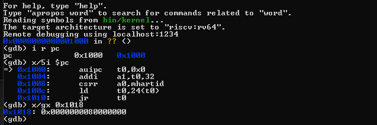
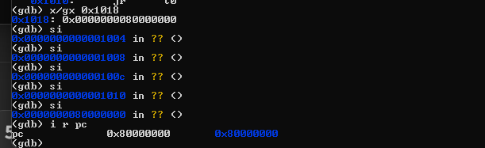
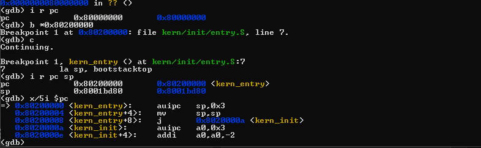
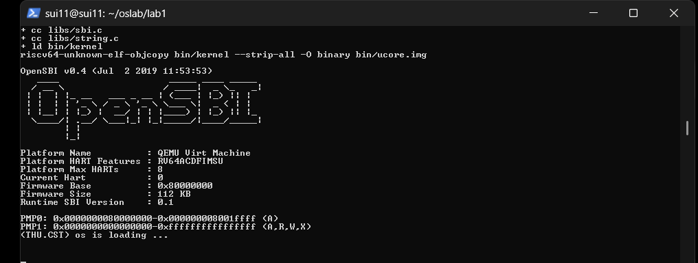

# 操作系统实验报告

## 实验基本信息

| 项目               | 内容                                           |
| ------------------ | ---------------------------------------------- |
| **实验名称** | Lab 1：比麻雀更小的麻雀（最小可执行内核）      |
| **小组成员** | 2412950-路浩斌、2411865-王泽浩、2413771-罗裕城 |
| **完成日期** | 2026-10-07                                     |

### 小组分工

| 成员           | 负责的练习/模块                           |
| -------------- | ----------------------------------------- |
| 2411865-王泽浩 | 实验环境配置、QEMU 运行验证与启动流程整理 |
| 2413771-罗裕城 | 练习1：理解内核启动中的程序入口操作       |
| 2412950-路浩斌 | 练习2：使用 GDB 验证启动流程              |

实验报告由小组成员共同完成。各成员整理自己负责部分的实验过程和理解，最后统一汇总、检查并形成最终版本。

---

## 一、实验目的

本实验的主要目的是：

1. 理解 uCore 最小可执行内核从 CPU 上电到进入 C 语言内核代码的基本启动流程。
2. 理解链接脚本、内核入口地址、启动栈以及 `entry.S` 在内核启动中的作用。
3. 熟悉 RISC-V 交叉编译工具链、QEMU、OpenSBI 和 GDB 的基本使用方法。
4. 通过实际调试观察并验证 `0x1000 → 0x80000000 → 0x80200000` 的启动控制流。

---

## 二、实验环境

### 2.1 基本实验环境

- WSL Ubuntu
- QEMU 4.1.1
- OpenSBI v0.4
- RISC-V 64 位交叉编译工具链
  - `riscv64-unknown-elf-gcc` 10.2.0
  - `riscv64-unknown-elf-ld` 2.35
  - `riscv64-unknown-elf-objcopy` 2.35
  - `riscv64-unknown-elf-gdb` 10.1
- GNU Make 4.3
- Git 2.34.1

### 2.2 AI 工具

| 成员           | AI 编程工具                                                | 底层模型    | 备注 |
| -------------- | ---------------------------------------------------------- | ----------- | ---- |
| 2412950-路浩斌 | ChatGPT（网页端）、Codex（VS Code 插件）                   | GPT-5.6 Sol | 无   |
| 2411865-王泽浩 | ChatGPT（网页端）、Codex（VS Code 插件）                   | GPT-5.6 Sol | 无   |
| 2413771-罗裕城 | ChatGPT（网页端）、Codex（VS Code 插件）、DeepSeek Harness | GPT-5.6 Sol | 无   |

---

## 三、实验整体逻辑分析

### 3.1 本章节的逻辑主线

我们对本章的理解是：先让一个很小的内核能够启动，再让它输出一句话，最后通过调试确认它是怎样运行起来的。

为了达到这个目标，首先需要安排内核各部分放在内存的什么位置，并确定从哪里开始执行。这部分由链接脚本和入口代码配合完成。进入内核后，入口汇编先设置栈指针，再跳转到 C 语言函数 `kern_init()`，由它完成清零 BSS 和输出信息等工作。

为了让 `kern_init()` 能够打印文字，还需要准备输出功能。内核中的格式化输出函数先把要输出的内容转换成字符，再通过 OpenSBI 提供的服务逐个输出。最后，用 Makefile 完成编译和镜像生成，使用 QEMU 运行，并通过 GDB 检查关键位置。

因此，本章的重点是把“内存布局、内核入口、基本输出、编译运行”这几个部分连接起来。我们看到终端上的一句提示信息，实际上说明这些部分已经能够配合工

### 3.2 实验实施顺序

1. **配置环境并启动内核**：在 WSL Ubuntu 中配置 RISC-V 工具链和 QEMU 4.1.1，检查各工具能否正常使用。进入 Lab1 目录执行 `make qemu`，确认内核能够成功启动并输出提示信息。
2. **练习1：分析内核入口**：阅读 `entry.S`，解释 `la sp, bootstacktop` 和 `tail kern_init` 分别完成什么操作，以及为什么需要先设置栈再进入 C 语言代码。
3. **练习2：用 GDB 跟踪启动流程**：分别运行 `make debug` 和 `make gdb`，查看 `0x1000` 处的初始指令并进行单步调试，再在 `0x80200000` 设置断点，确认 CPU 最终进入 `kern_entry`，记录调试输出与截图。

三个部分完成后，整理实验现象和练习答案，形成小组实验报告。

---

## 四、实验内容与实现

### 实验环境配置与 QEMU 运行验证

**负责人：2411865-王泽浩**

在 WSL Ubuntu 中准备实验环境。按照课程要求，从源码编译安装 QEMU 4.1.1，并配置 SiFive 的 RISC-V 交叉编译工具链和 GDB。

将 Lab1 实验代码放在 `~/oslab/lab1`，在该目录下执行：

```bash
make clean
make qemu
```

编译过程中，Makefile 依次编译、链接内核代码，生成 `bin/kernel`，再通过 `objcopy` 得到 `bin/ucore.img`。QEMU 启动后，终端显示 OpenSBI v0.4 的信息，并输出 `(THU.CST) os is loading ...`，说明内核能够正常启动并运行到 `kern_init()`。


---

### 练习1：理解内核启动中的程序入口操作

**负责人：2413771-罗裕城**

`kern/init/entry.S` 中的核心代码如下：

```asm
kern_entry:
    la sp, bootstacktop
    tail kern_init
```

#### 1. `la sp, bootstacktop`

`la` 是加载地址的伪指令，`sp` 是 RISC-V 的栈指针寄存器，`bootstacktop` 表示启动阶段内核栈的栈顶地址。

程序在 `.data` 段中通过 `.space KSTACKSIZE` 预留一块内存作为启动栈。RISC-V 栈通常从高地址向低地址增长，因此内核刚启动时需要将 `sp` 指向栈空间的高地址端，即 `bootstacktop`。

该指令的作用为将bootstacktop赋值给sp

其目的是在进入 C 语言函数之前建立一个有效的内核栈，为后续函数调用、局部变量以及寄存器保存等操作提供栈空间。

#### 2. `tail kern_init`

`tail kern_init` 的作用为将执行流程直接跳转到 C 语言实现的 `kern_init()` 函数。

`tail` 属于尾调用，不需要像普通 `call` 一样为后续返回保存新的返回地址。由于 `kern_init()` 被声明为 `noreturn`，执行后不会再返回到 `kern_entry`，因此这里可以直接使用尾调用。

因此，`entry.S` 的作用为：

> 在 OpenSBI 将控制权交给 uCore 后，先建立内核栈，再从汇编入口进入 C 语言实现的内核初始化函数。

---

### 练习2：使用 GDB 验证启动流程

**负责人：2412950-路浩斌**

#### 1. 启动调试环境

首先在一个终端执行：

```bash
make debug
```

该命令启动 QEMU，其中 `-S` 使虚拟 CPU 上电后立即暂停，`-s` 使 QEMU 在本机 1234 端口等待 GDB 连接。

在另一个终端执行：

```bash
make gdb
```

GDB 加载 `bin/kernel` 中的调试符号并连接 QEMU。连接成功后观察到：

```text
0x0000000000001000 in ?? ()
```

继续执行：

```gdb
i r pc
```

得到：

```text
pc = 0x1000
```

说明 RISC-V 模拟 CPU 上电后首先从 `0x1000` 开始执行。



#### 2. 分析 `0x1000` 处的最初几条指令

执行：

```gdb
x/5i $pc
```

观察到：

```asm
0x1000:  auipc   t0,0x0
0x1004:  addi    a1,t0,32
0x1008:  csrr    a0,mhartid
0x100c:  ld      t0,24(t0)
0x1010:  jr      t0
```

这些指令的主要作用如下：

- `auipc t0,0x0`：以当前 PC 为基准计算地址，此时 `t0` 得到 `0x1000`。
- `addi a1,t0,32`：计算得到 `a1 = 0x1020`，用于传递后续启动所需的参数地址。
- `csrr a0,mhartid`：读取当前 Hart ID，并保存到 `a0`。
- `ld t0,24(t0)`：从地址 `0x1018` 读取一个 64 位数据到 `t0`。
- `jr t0`：跳转到 `t0` 指向的地址。

进一步执行：

```gdb
x/gx 0x1018
```

观察到：

```text
0x1018: 0x0000000080000000
```

因此，`ld t0,24(t0)` 执行后 `t0 = 0x80000000`，随后 `jr t0` 将 PC 跳转到 `0x80000000`。

#### 3. 验证进入 OpenSBI

连续使用 `si` 单步执行，观察到 PC 的变化：

```text
0x1000
→ 0x1004
→ 0x1008
→ 0x100c
→ 0x1010
→ 0x80000000
```

随后执行：

```gdb
i r pc
```

得到：

```text
pc = 0x80000000
```

说明 CPU 已经从最初的复位启动代码跳转到 OpenSBI 所在区域。



#### 4. 验证进入 uCore 内核入口

在 GDB 中设置断点：

```gdb
b *0x80200000
```

随后继续运行：

```gdb
c
```

GDB 最终停止在：

```text
Breakpoint 1, kern_entry () at kern/init/entry.S:7
7           la sp, bootstacktop
```

此时查看寄存器：

```gdb
i r pc sp
```

得到：

```text
pc = 0x80200000 <kern_entry>
sp = 0x8001bd80
```

说明 OpenSBI 完成基础初始化后，最终将控制权转交到 `0x80200000`，CPU 开始执行 uCore 的第一条内核指令，即 `kern_entry` 中的 `la sp, bootstacktop`。



#### 5.调试结论

通过 GDB 实际观察，RISC-V 从上电到进入内核的关键控制流为：

```text
0x1000
  ↓
复位启动代码
  ↓
0x80000000
  ↓
OpenSBI
  ↓
0x80200000
  ↓
kern_entry
```

实验结果表明，RISC-V 硬件上电后并不会直接运行 uCore，而是先执行复位启动代码和 OpenSBI，在完成基础初始化之后再进入内核。

### 核心函数与功能模块的理解

除了两道练习中的入口指令，我们还需要理解内核怎样放进内存，以及进入 C 函数后怎样输出文字。下面按本项目的代码说明几个主要部分。

#### 1. 链接脚本决定内核的内存布局

`tools/kernel.ld` 中有两个比较重要的设置：

```ld
ENTRY(kern_entry)
BASE_ADDRESS = 0x80200000;
```

`ENTRY(kern_entry)` 指定生成的 ELF 文件的入口符号，`BASE_ADDRESS` 则配合后面的 `. = BASE_ADDRESS`，让内核各段从这个地址开始安排。我们可以先把链接脚本理解为一份内核的“位置安排”：代码放在哪里，常量放在哪里，数据又放在哪里。

本项目的主要区域包括 `.text`、`.rodata`、`.data` 和 `.bss`。`.text` 存放指令，`.rodata` 存放只读数据，`.data` 存放可写数据，本实验的启动栈也安排在这里；`.bss` 则用于需要初始为零的数据，例如未显式初始化的全局变量。

脚本中的 `ALIGN(0x1000)` 表示把地址对齐到 4096 字节的整数倍。它只是安排地址，并不表示内核已经开启了分页。

链接脚本确定的是程序的地址布局，实际加载镜像还需要 QEMU 启动参数配合。对于本实验的原始二进制镜像，加载位置和内核入口必须与链接时的安排一致，否则 CPU 可能跳到没有正确内核指令的位置。

#### 2. kern_init 完成进入内核后的基本工作

在 `kern/init/init.c` 中，`kern_init()` 的主要工作很少，可以分成清零、输出和循环三步。

首先是：

```c
extern char edata[], end[];
memset(edata, 0, end - edata);
```

`edata` 和 `end` 是链接脚本定义的符号，分别标记初始化数据区域结束处和 BSS 区域结束处。这段代码把两者之间的内存清零，使 BSS 中的数据具有正确的初始值。在普通应用程序中，这些准备通常由加载程序或运行时完成；现在我们正在启动内核，所以代码里需要明确完成这些工作。

接着是：

```c
const char *message = "(THU.CST) os is loading ...\n";
cprintf("%s\n\n", message);
```

这段代码输出启动提示。它不仅让我们知道程序正在运行，也帮助我们判断执行流程是否已经从汇编入口进入了 C 函数。这里的 `cprintf()` 是 uCore 项目自己提供的函数，使用的头文件也是项目中的 `stdio.h`。

最后是：

```c
while (1)
    ;
```

Lab1 还没有任务调度等后续工作，所以让 CPU 保持在循环中。它不是程序意外卡死，也不表示操作系统已经关机，而是这个最小内核目前的预期行为。

函数声明中的 `noreturn` 用来告诉编译器该函数不会正常返回；真正让执行流程不返回的，是函数末尾的无限循环。

#### 3. cprintf 怎样把文字输出到终端

阅读源码可以看到，`cprintf()` 并没有直接操作屏幕，而是调用其他函数逐步完成输出。主要过程如下：

```text
cprintf → vcprintf → vprintfmt
                       ↓ 通过 cputch 逐个输出字符
                    cons_putc
                       ↓
               sbi_console_putchar
                       ↓
                   sbi_call
                       ↓
                     ecall
                       ↓
              OpenSBI 处理输出请求
```

`cprintf()` 和 `vcprintf()` 负责整理传入的参数，`vprintfmt()` 处理 `%s`、`%d` 等格式，并通过 `cputch()` 输出字符。`cputch()` 调用 `cons_putc()`，同时统计输出的字符数；`cons_putc()` 再调用 `sbi_console_putchar()`。

在本项目使用的旧版 SBI 接口中，`sbi_console_putchar()` 把字符输出服务编号和字符交给 `sbi_call()`。`sbi_call()` 通过寄存器传递这些信息，并执行 `ecall`，让运行在 M 模式的 OpenSBI 处理请求。处理完成后，执行流程再回到内核。

我们对这部分的理解是：格式化函数负责决定“输出什么”，底层接口负责完成“怎样输出”。因此，终端上看起来很简单的一行文字，实际上需要好几个函数配合。以后查看其他模块时，也可以沿着调用关系理解每一层的作用。

#### 4. Makefile 把源代码变成可运行的镜像

Makefile 将编译和链接等命令组织起来，并记录各文件之间的依赖关系。本实验的主要构建过程是：

```text
C 和汇编源文件 → 目标文件 .o → bin/kernel（ELF）→ bin/ucore.img（原始二进制）
```

交叉编译器负责生成 RISC-V 指令，链接器根据 `kernel.ld` 将各目标文件组合起来，再由 `objcopy` 生成原始二进制镜像。

`bin/kernel` 带有符号和调试信息，因此 GDB 可以把地址对应到函数名和源代码。`bin/ucore.img` 用来加载运行，它不带 ELF 文件头，也不会自己说明应该从哪个地址开始执行；加载地址需要由启动配置确定。

这里的“镜像”是内核的二进制数据，不代表本实验已经建立了文件系统或完成了硬盘启动。当前项目使用 QEMU 直接加载内核镜像。

---

## 五、测试与验证

执行：

```bash
make clean
make qemu
```

项目能够正常完成编译、链接和镜像生成，并成功启动 QEMU。运行过程中可以看到 OpenSBI 的启动信息，最后输出：



该输出说明 CPU 已经成功进入 `kern_init()` 并完成基本的格式化输出，最小可执行内核启动成功。

此外，通过 GDB 成功观察到了 `0x1000 → 0x80000000 → 0x80200000` 的启动过程，验证结果与指导书中的启动流程一致。

---

## 六、实验总结与收获

### 6.1 对操作系统的理解

通过本次实验，我们对操作系统启动过程有了更直观的认识。操作系统内核并不是 CPU 上电后的第一段程序。在本实验的 RISC-V 环境中，CPU 首先从 `0x1000` 执行复位启动代码，随后进入 `0x80000000` 的 OpenSBI，最后才将控制权交给位于 `0x80200000` 的 uCore 内核。

本实验中比较重要的知识点包括：

1. **操作系统启动** ：操作系统并不是 CPU 上电后直接运行的，而是需要经过固件初始化和引导过程，才能进入内核。
2. **内存布局** ：程序的代码段、数据段和栈需要占用不同的内存空间，本实验通过链接脚本确定内核的内存布局。
3. **栈与函数调用** ：栈用于保存局部变量和函数调用过程中的相关数据，进入 C 语言函数前需要先设置好栈指针。
4. **CPU 特权级** ：RISC-V 具有不同的特权级，不同特权级拥有不同的执行权限。OpenSBI 运行在 M 模式，操作系统内核通常运行在 S 模式。

### 6.2 AI 协作开发的经验

AI 能够帮助我们快速学习新知识，也能协助我们完成一些不熟悉的工作，提高学习和实践的效率。但 AI 本身也存在一定的局限性，它给出的解决方案有时可能存在潜在的问题。如果缺乏相关的基础知识，就很难及时发现这些问题，甚至可能因此走弯路。此外，AI 对知识的解释也不一定完全准确，可能使我们产生理解上的偏差。因此，不能完全依赖 AI 给出的答案，还是需要通过实际操作和验证，才能真正理解并掌握相关知识。
