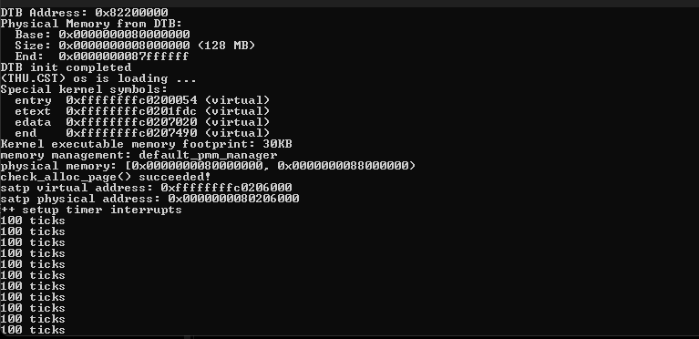
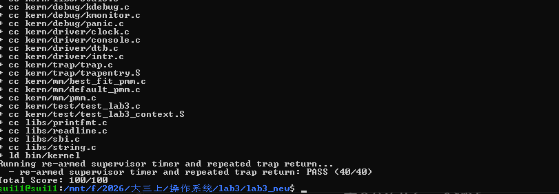

# 操作系统实验报告

## 实验基本信息

| 项目 | 内容 |
| --- | --- |
| **实验名称** | Lab 3：中断与异常处理 |
| **小组成员** | 2412950-路浩斌、2411865-王泽浩、2413771-罗裕城 |
| **完成日期** | 2026-11-08 |

### 小组分工

**练习如何分工？**

| 成员 | 负责的练习/模块 |
| --- | --- |
| 2412950-路浩斌 | 功能模块一：`RESTORE_ALL`、`__alltraps` 与 Trap 上下文恢复 |
| 2411865-王泽浩 | 功能模块二：`interrupt_handler()`、周期性时钟中断 |
| 2413771-罗裕城 | 功能模块二：`exception_handler()`、非法指令与断点异常 |

**实验报告如何分工？**

路浩斌负责整理 Trap 入口、寄存器保存与恢复以及报告总体逻辑；王泽浩负责中断处理、时钟计数和测试结果整理；罗裕城负责异常处理、`epc` 更新与相关原理。三名组员共同完成实验分析、AI 辅助开发记录和报告校对。

---

## 一、实验目的

本实验在前两次实验的内核启动和物理内存管理基础上，实现 RISC-V 操作系统的基本中断与异常处理机制。主要目标如下：

1. 理解中断与异常的基本概念，掌握 `stvec`、`scause`、`sepc`、`sstatus`、`sscratch` 等 RISC-V 特权寄存器的作用。
2. 理解 Trap 发生时处理器状态的保存方式，掌握 `TrapFrame`、`SAVE_ALL` 和 `RESTORE_ALL` 的关系。
3. 完成汇编 Trap 入口 `__alltraps`，实现汇编入口与 C 语言处理函数 `trap(struct trapframe *tf)` 的衔接。
4. 实现时钟中断处理，掌握下一次时钟事件设置、`ticks` 累加和周期性输出。
5. 实现非法指令异常和断点异常处理，正确修改异常返回地址 `epc`，使程序能够继续执行。
6. 使用 QEMU 运行内核，通过 `make qemu` 和 `make grade` 验证实验功能，掌握 AI 辅助实现系统底层代码的基本方法。

---

## 二、实验环境

本实验在 Windows + WSL 的 Linux 开发环境中进行，使用 VS Code 编辑源码，使用 RISC-V 交叉编译工具链生成内核镜像，并通过课程指定的 QEMU 环境运行和测试。

| 项目 | 使用环境 |
| --- | --- |
| 操作系统 | Windows、WSL CTF-Ubuntu |
| 实验工程 | riscv64-uCore Lab3，`lab3_new/` |
| 代码语言 | C、RISC-V 汇编 |
| 开发工具 | VS Code、GNU Make、Git |
| 交叉编译器 | SiFive RISC-V GCC-Metal 10.2.0 |
| 模拟器 | QEMU 4.1.1，`virt` 机器 |
| 启动固件 | OpenSBI v0.4 |
| 调试与测试 | RISC-V GDB、`make qemu`、`make grade` |

**本组使用的 AI 工具：**

| 成员 | AI 编程工具 | 底层模型 | 备注 |
| --- | --- | --- | --- |
| 2412950-路浩斌 | Codex（VS Code）、ChatGPT（网页端） | GPT-6.1 Sol、GPT 系列 | 代码实现与实验整理 |
| 2411865-王泽浩 | ChatGPT（网页端）、Codex（VS Code） | GPT 系列 | 中断模块讨论与分析 |
| 2413771-罗裕城 | ChatGPT（网页端）、Codex（VS Code） | GPT 系列 | 异常模块讨论与分析 |

实验的主要源码文件为 `kern/trap/trapentry.S`、`kern/trap/trap.c`、`kern/trap/trap.h`、`kern/driver/clock.c`。本实验复用 Lab2 中已实现的物理内存初始化及分配器代码，Lab3 正常运行时按工程原有配置使用 `default_pmm_manager`（First-Fit），保持统一的 `pmm_manager` 接口与测试框架。

---

## 三、实验整体逻辑分析

### 3.1 本章节的逻辑主线

Lab3 的核心问题是：**CPU 在执行程序时发生中断或异常，操作系统怎样保存当前执行状态，完成处理后再回到原来的执行流程？**

中断一般由定时器或外设事件触发，具有异步性；异常则与当前正在执行的指令有关，如断点指令和非法指令。两者都会进入 Trap 处理流程，但具体处理方式不同。

```text
CPU 正常执行指令
        ↓
发生中断或异常（Trap）
        ↓
CPU 根据 stvec 进入 __alltraps
        ↓
SAVE_ALL 保存通用寄存器和 CSR → TrapFrame
        ↓
把 TrapFrame 指针放入 a0，调用 trap(tf)
        ↓
trap_dispatch(tf) 根据 scause 分类
        ├── 中断：interrupt_handler(tf)
        │      └── 设置下次定时事件、累加 ticks
        └── 异常：exception_handler(tf)
               └── 识别异常并更新 epc
        ↓
返回 __trapret
        ↓
RESTORE_ALL 恢复执行现场
        ↓
sret 返回原执行流
```

整条逻辑可以分为三个部分：首先由汇编代码完成 Trap 上下文的保存与恢复；其次由 C 语言代码识别中断或异常；最后由处理器按照恢复后的 `sepc` 和 `sstatus` 返回。只有三个部分互相配合，才能正确处理中断并继续执行程序。

### 3.2 功能的逐步实现

1. **理解 TrapFrame 和原有入口。** 阅读 `trap.h`、`trapentry.S` 和 `trap.c`，明确寄存器的保存位置、Trap 入口以及 C 语言分发函数。
2. **实现 `RESTORE_ALL`。** 对照已有 `SAVE_ALL`，恢复通用寄存器、`sstatus`、`sepc` 和原始栈指针 `sp`。
3. **完成 `__alltraps`。** 将栈上的 TrapFrame 地址放入 `a0`，调用 `trap()`，处理后进入 `__trapret`。
4. **实现中断处理。** 根据 `scause` 识别 Supervisor 时钟中断，并在每次中断后重新设置下一次定时事件，累加 `ticks`。
5. **实现异常处理。** 识别非法指令和断点异常，输出异常位置，按照指令长度更新 `epc`。
6. **完成实验验证。** 通过 QEMU 观察时钟中断的连续输出，再使用自动评分验证 Trap 上下文、异常返回与时钟中断三个模块。

---

## 四、实验内容与实现

### 功能模块一：Trap 上下文恢复与 Trap 入口功能

**负责人：2412950-路浩斌**

#### 模块功能描述

**需要实现/修改的汇编功能和接口：**

```asm
.macro RESTORE_ALL
    # 按 TrapFrame 的布局恢复处理器上下文
.endm

.globl __alltraps
__alltraps:
    # 保存现场并调用 trap
```

```c
void trap(struct trapframe *tf);
```

**功能说明：**

Trap 发生后，硬件将执行位置转移到 `stvec` 指定的 `__alltraps`。已有的 `SAVE_ALL` 在栈上预留 `36 * REGBYTES` 字节，用来保存 32 个通用寄存器槽位以及四个 CSR 槽位。`struct trapframe` 与这个存储布局保持一致：前面是 `struct pushregs`，后面依次是 `status`、`epc`、`badvaddr` 和 `cause`。

`RESTORE_ALL` 与 `SAVE_ALL` 对应，恢复 `sstatus`、`sepc` 等处理器状态，再恢复通用寄存器，最后处理原始 `sp`。原有 `SAVE_ALL` 使用 `sscratch` 暂存陷入前的栈指针，并将其放在 TrapFrame 中的第 2 号槽位，因此 `sp` 必须独立处理，不能在寄存器全部恢复之前破坏当前 TrapFrame 的地址。

`__alltraps` 在执行 `SAVE_ALL` 后，令 `a0 = sp`，把当前 TrapFrame 指针作为第一个参数传给 `trap()`。`trap()` 返回后进入 `__trapret`，执行 `RESTORE_ALL`，最后通过 `sret` 返回。

**TrapFrame 的关键布局：**

| 槽位 | 内容 | 作用 |
| --- | --- | --- |
| `0～31` | `x0～x31` 的对应保存位置 | 保留通用寄存器状态，其中 `x2` 单独保存原始 `sp` |
| `32` | `sstatus` | 保存 Trap 前处理器状态 |
| `33` | `sepc` | 保存返回时的程序计数器 |
| `34` | `sbadaddr` | 记录异常相关地址 |
| `35` | `scause` | 记录中断或异常原因 |

#### 核心代码与实现分析

**Trap 入口和 C 函数衔接：**

```asm
__alltraps:
    SAVE_ALL
    mv a0, sp
    jal trap
```

`SAVE_ALL` 在当前栈上建立 TrapFrame。`mv a0, sp` 使用 RISC-V 函数调用约定，把 TrapFrame 首地址作为第一个参数传给 C 函数 `trap()`。处理函数返回后执行统一的 `__trapret`，恢复寄存器并通过 `sret` 返回。

**`RESTORE_ALL` 的两个关键点：**

```asm
    LOAD s1, 32*REGBYTES(sp)
    LOAD s2, 33*REGBYTES(sp)
    csrw sstatus, s1
    csrw sepc, s2
    # 其他通用寄存器按 SAVE_ALL 的保存槽位恢复
    LOAD sp, 2*REGBYTES(sp)
```

这是恢复操作中的关键指令关系：第 32、33 号槽对应 `sstatus`、`sepc`，第 2 号槽保存 Trap 发生前的 `sp`。**原始 `sp` 必须在其他寄存器恢复完成后再读取**，否则后续以当前 `sp` 为基址的 TrapFrame 访问会出错。这里省略的通用寄存器仍需按 `SAVE_ALL` 的槽位逐个恢复。

**独立 Spec：**

| 规格 | 内容 |
| --- | --- |
| Pre-Condition | `SAVE_ALL` 已按照 `struct trapframe` 布局保存寄存器和 CSR |
| Post-Condition | `RESTORE_ALL` 恢复保存的 CPU 状态，`sret` 返回到正确位置 |
| Case 1 | 普通 Trap：保存现场，调用 C 处理函数，再恢复现场 |
| Case 2 | 处理函数更新 `tf->epc`：恢复后的 `sepc` 应使用更新值 |
| Case 3 | 原始 `sp` 与保存 TrapFrame 时的临时栈指针不同：正确恢复原始 `sp` |
| Requirements | 保持 `SAVE_ALL`、`struct trapframe` 和 `trap()` 的函数签名不变 |

#### 最终提示词

````markdown
[PROMPT]
**任务**：修改 `kern/trap/trapentry.S` 中的 Lab3 功能模块一，实现 `RESTORE_ALL` 宏及 `__alltraps` 汇编入口，使内核完成“Trap 进入 → 保存现场 → 调用 C 语言 `trap()` → 恢复现场 → `sret` 返回”的完整流程。

**操作要求**：必须直接修改项目中的真实文件，而不是只展示汇编代码。在 `lab3 function1 YOUR CODE` 标记对应位置补全，保留原有 `SAVE_ALL`、`__trapret`、`struct trapframe` 与 `trap()` 接口，不改动其他源文件、Makefile 和测试脚本；保留实验标记，按提交要求填写对应学号。以当前工程中真实的保存布局和 RISC-V 调用约定为准。

**输出要求**：直接完成文件修改。使用以下 `[RELY]`、`[GUARANTEE]`、`[SPECIFICATION]` 中的已有接口和行为约束；完成后说明寄存器与 CSR 的恢复依据、`sp` 的特殊处理、汇编与 C 函数的参数传递关系，并给出编译与测试结果。

[RELY]
**可依赖的宏、结构和保存布局：**
- `libs/riscv.h` 提供 `REGBYTES`、`LOAD`、`STORE`，RV64 下 `REGBYTES=8`、`LOAD=ld`、`STORE=sd`。
- `kern/trap/trapentry.S` 中已有的 `SAVE_ALL` 预留 `36 * REGBYTES` 的 Trap frame：第 `0～31` 号槽对应通用寄存器，其中 `x2(sp)` 的原值通过 `sscratch` 放到第 2 号槽；第 `32～35` 号槽依次保存 `sstatus`、`sepc`、`sbadaddr`、`scause`。
- `kern/trap/trap.h` 中 `struct trapframe` 依次包含 `struct pushregs gpr`、`uintptr_t status`、`epc`、`badvaddr`、`cause`，其布局必须与 `SAVE_ALL` 一致。
- 已有接口 `void trap(struct trapframe *tf);`；已有符号 `__trapret`、`SAVE_ALL`；可使用 `sscratch`、`sstatus`、`sepc` 等 CSR 和特权返回指令 `sret`。
- RISC-V 调用约定使用 `a0` 传递第一个参数；`trap()` 返回后仍需能从当前 Trap frame 正确恢复上下文。

[GUARANTEE]
**必须实现或修改的汇编接口：**
```asm
.macro RESTORE_ALL
    # 恢复 Trap frame 中的处理器现场
.endm

.globl __alltraps
__alltraps:
    # 建立 Trap frame 并调用 C 语言 trap()
```
**对外衔接接口（保持已有定义，不重新实现）：**
```c
void trap(struct trapframe *tf);
```
可按需要使用汇编内部临时寄存器，不新增对外接口；保留 `__trapret` 中的 `sret` 返回逻辑。

[SPECIFICATION]
## RESTORE_ALL
**Pre-Condition：**
- `SAVE_ALL` 已完成现场保存，当前 `sp` 指向合法的 Trap frame；保存槽位与 `struct trapframe` 对应。
- C 语言处理函数已经返回；处理过程中允许通过 Trap frame 更新 `epc` 等需要恢复的状态。

**Post-Condition：**
- 保存的通用寄存器与必要的处理器控制状态正确恢复；`sp` 恢复为 Trap 之前的原值。
- 恢复后的 `sepc` 反映 Trap frame 中的最终返回地址，处理器可以通过 `sret` 回到正确的执行流。

**Case 1：普通中断处理完成。** 在处理函数返回后恢复被中断代码的寄存器、状态和栈，使原执行流能够继续运行。

**Case 2：异常处理更新返回地址。** 当 C 函数修改 Trap frame 中的 `epc` 时，恢复后的 `sepc` 必须使用更新值，以便从调整后的指令位置继续执行。

**Case 3：栈指针特殊恢复。** Trap 发生时的原始 `sp` 保存在第 2 号槽位，而当前 `sp` 用于访问 Trap frame；必须在其他必要恢复操作完成后再恢复原始 `sp`，不能提前破坏现场访问基址。

**Requirements：** 严格遵循已有 `SAVE_ALL` 的真实布局，不重定义 Trap frame；恢复过程中不得破坏尚未读取的保存内容，不修改 `SAVE_ALL` 和 `__trapret` 的原有功能。

## __alltraps
**Pre-Condition：**
- CPU 根据已配置的 `stvec` 进入 `__alltraps`，当前具备保存处理器上下文所需的合法栈空间。
- 工程中已有 `SAVE_ALL`、`trap(struct trapframe *tf)` 和 `__trapret`。

**Post-Condition：**
- Trap 发生时的现场保存为与 `struct trapframe` 一致的内存布局，并把该 Trap frame 的地址正确传给 `trap()`。
- `trap()` 处理结束后，能够进入统一的现场恢复与 Trap 返回流程，保留处理函数对 Trap frame 的合法修改。

**Case 1：处理中断。** 将保存好的上下文传入 `trap()`，处理完成后保持原执行位置及上下文一致，继续运行原程序。

**Case 2：处理需要调整 `epc` 的异常。** 将同一份可修改的 Trap frame 传入 `trap()`；返回时允许恢复逻辑读取修改后的执行地址。

**Requirements：** 按 RISC-V ABI 使用 `a0` 传入 `struct trapframe *`；调用结束后栈指针应仍指向原 Trap frame，以便 `RESTORE_ALL` 正常执行；不改变 `trap()` 的签名和框架原有处理链路。
````

#### 实现迭代过程

##### 第一次迭代：核对 `SAVE_ALL` 与 TrapFrame 的槽位

**问题及原因：** `SAVE_ALL` 对 `x2(sp)` 的保存方式与其他通用寄存器不同，若直接按普通寄存器的方式套用恢复模板，会破坏后续读取 TrapFrame 所需的栈指针。本次先核对 `trapentry.S` 与 `trap.h`，确认 36 个槽位的布局及 `sscratch` 的作用，再明确恢复顺序。

**解决办法：** 在 Prompt 的 `[RELY]` 中列出 `SAVE_ALL` 的真实槽位，在 `[SPECIFICATION]` 中单独规定 `sp` 的恢复时序，并要求调用 `trap()` 时不破坏 TrapFrame 基址。

##### 第二次迭代：完成入口与返回衔接

**实现与验证：** 补全 `RESTORE_ALL` 和 `__alltraps`，使用 `a0` 传递 TrapFrame 指针；由 `trap()` 返回后进入 `__trapret`，通过恢复后的 `sepc` 和 `sstatus` 执行 `sret`。编译和自动测试验证了断点后的正确返回。

##### 最终结果

Trap 上下文保存、寄存器恢复和断点异常返回通过自动评分第一项，**Test 1：35/35**。本模块的重点是避免栈指针恢复时序错误、确保 C 处理函数能够修改并传回同一份 TrapFrame。

---

### 功能模块二：中断与异常处理功能

**负责人：2411865-王泽浩（中断）；2413771-罗裕城（异常）**

#### 模块功能描述

**需要实现/修改的函数：**

```c
void interrupt_handler(struct trapframe *tf);
void exception_handler(struct trapframe *tf);
```

**功能说明：**

`trap_dispatch()` 根据 `tf->cause` 的最高位判断当前 Trap 属于中断还是异常，并把 TrapFrame 交给对应处理函数。

**（一）中断处理 `interrupt_handler()`**

收到 Supervisor 时钟中断 `IRQ_S_TIMER` 时，调用 `clock_set_next_event()` 预约下一次定时器事件，然后将 `ticks` 加一。当 `ticks` 达到 `TICK_NUM`（100）的整数倍时调用 `print_ticks()`，在终端显示 `100 ticks`。通过每次处理后重新设置定时事件，内核能够持续接收时钟中断。对 Supervisor 软件中断输出 `Supervisor software interrupt`；对 Supervisor 外部中断 `IRQ_S_EXT` 输出 `Supervisor external interrupt`；对无法识别的中断输出原因并调用 `print_trapframe(tf)`。

本实验时钟相关的函数和数据已经由 `kern/driver/clock.c` 提供，直接复用 `clock_init()`、`clock_set_next_event()` 和 `ticks`；对于实验配置的 `SHUTDOWN_AFTER` 阈值，使用框架提供的 `sbi_shutdown()` 接口处理关机。

**（二）异常处理 `exception_handler()`**

根据 `tf->cause` 区分非法指令 `CAUSE_ILLEGAL_INSTRUCTION`、断点 `CAUSE_BREAKPOINT` 及其他异常。非法指令输出 `Illegal instruction at ...`，断点输出 `Breakpoint at ...`。两者处理完后均需更新 `tf->epc`，使 `sret` 返回后能够继续执行触发异常指令后面的代码。

由于 RISC-V 可能包含 16 位压缩指令和 32 位普通指令，异常返回地址的推进长度需要根据指令编码确定，不能固定为 4 字节。其他异常使用 `print_trapframe(tf)` 打印完整现场信息。

#### 核心代码与实现分析

**时钟中断的处理逻辑：**

```c
case IRQ_S_TIMER:
    clock_set_next_event();
    ticks++;
    if (ticks % TICK_NUM == 0) {
        print_ticks();
    }
    break;
```

`clock_set_next_event()` 安排下一次时钟事件；`ticks++` 记录本次中断；每累计 100 次调用 `print_ticks()`。这与 `make qemu` 截图中连续出现的 `100 ticks` 对应。累计统计达到实验配置的关机阈值时，处理函数通过 `sbi_shutdown()` 结束运行。

**Supervisor 外部中断分类：**

```c
case IRQ_S_EXT:
    cprintf("Supervisor external interrupt\n");
    break;
```

`IRQ_S_EXT` 用来识别 Supervisor 外部中断，不与时钟中断混为一类。未识别的中断走默认分支，输出原因和 TrapFrame。

**异常返回地址的调整：**

```c
uint16_t instruction = *(const uint16_t *)tf->epc;
tf->epc += (instruction & 3) == 3 ? 4 : 2;
```

RISC-V 普通 32 位指令的低两位为 `11`，而本实验涉及的 16 位压缩指令低两位不是 `11`。因此这段代码根据指令编码将 `epc` 前进 4 字节或 2 字节，防止 `sret` 后再次执行触发异常的指令。非法指令和断点异常都需要处理这一问题。

**独立 Spec：**

| 规格 | 中断处理 | 异常处理 |
| --- | --- | --- |
| Pre-Condition | TrapFrame 的 `cause` 已保存，时钟驱动已初始化 | TrapFrame 中的 `cause` 和 `epc` 已保存 |
| Post-Condition | 完成事件处理，时钟中断能够持续触发并返回 | 更新返回位置，避免重复执行触发异常的指令 |
| Case 1 | `IRQ_S_TIMER`：设置下一事件，`ticks++`，每 100 次输出统计 | 非法指令：输出异常地址并推进 `epc` |
| Case 2 | `IRQ_S_SOFT`：输出软件中断提示 | 断点：输出断点地址并推进 `epc` |
| Case 3 | `IRQ_S_EXT`：输出 Supervisor 外部中断提示 | 其他异常：调用 `print_trapframe(tf)` |
| Case 4 | 未知中断：输出原因和 TrapFrame | — |
| Requirements | 复用现有时钟接口和 `TICK_NUM`，保持正常返回；配合条件关机接口 | 按实际指令长度推进 `epc`，保持原函数接口与分发流程不变 |

#### 最终提示词

````markdown
[PROMPT]
**任务**：修改 `kern/trap/trap.c` 的 Lab3 功能模块二，实现 `interrupt_handler(struct trapframe *tf)` 和 `exception_handler(struct trapframe *tf)`，使内核能够识别并处理 Supervisor 时钟中断、软件中断、外部中断、非法指令异常与断点异常，并正确返回 Trap 前的执行流程。

**操作要求**：必须直接修改工程中的真实 `kern/trap/trap.c` 文件，只在 `lab3 function2 YOUR CODE` 所标记的位置完成指定功能；保留原有 `idt_init()`、`trap_dispatch()`、`trap()`、`print_ticks()`、`print_trapframe()` 以及时钟驱动和测试代码。不得修改函数签名、其他框架逻辑、Makefile 或评分脚本；保留实验标记并按提交要求填写对应学号。

**输出要求**：根据以下 `[RELY]`、`[GUARANTEE]`、`[SPECIFICATION]` 直接完成文件修改。以工程真实的宏定义、Trap frame 字段和输出函数为准；完成后说明各 Trap 分支的行为、时钟事件重复设置、`epc` 更新规则和测试结果，不引入无关功能。

[RELY]
**可依赖的宏、数据结构、全局变量和函数：**
- `kern/trap/trap.h` 提供 `struct trapframe`，其 `cause` 表示 Trap 原因，`epc` 表示返回时执行位置；已有 `void print_trapframe(struct trapframe *tf);`。
- `kern/trap/trap.c` 已有 `trap_dispatch()`、`trap()`、`print_ticks()`，并定义 `TICK_NUM=100`；`print_ticks()` 会输出 `100 ticks`。
- `kern/driver/clock.h` 声明 `extern volatile size_t ticks;` 与 `void clock_set_next_event(void);`；时钟驱动已实现定时器初始化及下一事件设置。
- `libs/riscv.h` 提供 `IRQ_S_SOFT=1`、`IRQ_S_TIMER=5`、`IRQ_S_EXT=9`、`CAUSE_ILLEGAL_INSTRUCTION=0x2`、`CAUSE_BREAKPOINT=0x3`；`tf->cause` 的最高位区分中断与异常。
- `libs/sbi.h` 提供 `void sbi_shutdown(void);`；指导书以 `SHUTDOWN_AFTER` 描述统计输出达到指定次数后的关机条件，取值以工程或实验明确提供的配置为准。
- 可使用现有 `cprintf()` 输出提示信息；其他 Trap 类型可使用 `print_trapframe(tf)` 进行诊断。

[GUARANTEE]
**必须实现的函数接口（名称和签名保持一致）：**
```c
void interrupt_handler(struct trapframe *tf);
void exception_handler(struct trapframe *tf);
```
这两个函数应由原有 `trap_dispatch()` 分发调用；可以增加仅用于本模块的 `static` 辅助函数，不修改公开接口。

[SPECIFICATION]
## interrupt_handler(struct trapframe *tf)
**Pre-Condition：**
- `tf` 指向已保存的合法 Trap frame，`tf->cause` 记录了本次中断原因。
- 时钟中断处理前，内核已完成时钟驱动初始化，`ticks` 为当前时钟中断累计次数。

**Post-Condition：**
- 已识别的中断按规定处理；Supervisor 时钟中断能够连续触发，计数和输出符合实验要求。
- 正常处理完成后可以返回统一 Trap 恢复路径；对未知中断提供完整诊断信息。

**Case 1：Supervisor 时钟中断（`IRQ_S_TIMER`）。** 每次接收事件后都应设置下一次时钟事件，使计数器 `ticks` 恰好增加一次；每达到 `TICK_NUM` 的整数倍输出一次规定的统计信息。若实验配置了 `SHUTDOWN_AFTER`，累计输出达到指定次数后调用已有关机接口。

**Case 2：Supervisor 软件中断（`IRQ_S_SOFT`）。** 输出 `Supervisor software interrupt`，并正常返回，不错误改变时钟计数或同步异常返回位置。

**Case 3：Supervisor 外部中断（`IRQ_S_EXT`）。** 输出 `Supervisor external interrupt`，并正常返回，不修改时钟计数。

**Case 4：未知中断。** 输出 `Unknown interrupt: cause ...` 并调用 `print_trapframe(tf)`，便于定位中断来源，不将未知原因当作时钟中断处理。

**Requirements：** 不遗漏下一次时钟事件设置，不重复累加同一次中断；保持与已有 `trap_dispatch()` 和 Trap 返回机制兼容；不擅自给未定义的关机阈值赋值。

## exception_handler(struct trapframe *tf)
**Pre-Condition：**
- `tf` 指向合法 Trap frame；其中 `cause` 可用于识别同步异常，`epc` 记录触发异常的指令地址。
- 处理过程能够读取判断指令长度所需的信息，且已建立的 Trap 处理链路能够使用修改后的 `epc` 返回。

**Post-Condition：**
- 非法指令和断点异常按实验规定输出诊断信息；对于需要继续执行的异常，Trap frame 中保存的返回位置已调整至下一条指令。
- 未专门处理的异常能够输出现场信息，而不被误判成已实现的异常类型。

**Case 1：非法指令异常（`CAUSE_ILLEGAL_INSTRUCTION`）。** 输出 `Illegal instruction at ...`，根据触发指令的实际编码长度更新 `tf->epc`，使后续 Trap 返回不会重复执行同一条非法指令。

**Case 2：断点异常（`CAUSE_BREAKPOINT`）。** 输出 `Breakpoint at ...`，根据触发断点的指令长度更新 `tf->epc`，使处理返回后继续执行断点之后的指令。

**Case 3：其他异常。** 使用 `print_trapframe(tf)` 输出完整 Trap frame，不自行引入指导书未要求的异常恢复策略。

**Requirements：** 兼容 RISC-V 16 位压缩指令和 32 位普通指令的长度差异，不能对所有异常固定增加 4 字节；保持原有中断/异常分发和函数接口不变。
````

#### 实现迭代过程

##### 第一次迭代：实现中断与异常分支

**实现过程：** 对照 `trap_dispatch()` 和 `riscv.h` 中的原因编号，在 `interrupt_handler()` 中处理 Supervisor 时钟中断和软件中断，在 `exception_handler()` 中处理非法指令与断点异常。时钟分支每次都重新设置定时事件，并使用 `TICK_NUM` 控制统计输出；异常分支按照指令长度推进 `tf->epc`。

##### 第二次迭代：完善外部中断分类

**发现的问题：** 初期的中断分类重点覆盖了时钟中断、软件中断和未知中断。对照已有 `IRQ_S_EXT` 宏检查后，发现 Supervisor 外部中断也应有独立提示，不能全部归入未知中断。

**调整方法：** 增加 `IRQ_S_EXT` 分支，输出 `Supervisor external interrupt`，保留未知中断的 `print_trapframe(tf)` 兜底。此项属于处理类型的完善，并非导致评分失败的 Bug。

##### 第三次迭代：修复 Lab2 依赖留空造成的验收阻碍

**实际遇到的问题：** Codex 最初优先完成了 `trapentry.S` 和 `trap.c`，但 Lab3 原始工程仍留有 Lab2 的物理内存初始化和 Best-Fit 实现位置。没有补齐这些基础依赖，评分流程无法正常进入完整的 Trap 运行测试。

**原因分析：** Lab3 建立在 Lab2 内存管理基础上，启动时需要先执行 `pmm_init()` 和 `page_init()`，随后才会初始化 Trap 入口与定时器。只补全 Trap 模块而遗漏前置内存管理代码，会阻断后续功能验证。

**解决策略：** 对比上次已经通过验证的 Lab2 实现，只迁移 `pmm.c` 中缺少的 `page_init()` 及 `best_fit_pmm.c` 中对应的管理器实现，保持现有 `pmm_manager` 默认选择、Trap 模块和原测试逻辑不变。随后重新编译并运行测试。

##### 最终结果

**Test 2：25/25，Test 3：40/40**；结合 Trap 上下文模块第一项 **35/35**，原生 `make grade` 最终得到 **100/100**。`make qemu` 的连续 `100 ticks` 输出也验证了中断可以重复触发和返回。

---

### 练习：Trap 处理流程中的关键问题

**负责人：全组**

**1. 为什么中断发生后需要保存寄存器？**

因为中断处理函数可能使用和修改原程序中的寄存器。只有先保存 Trap 前的状态，处理完成后再恢复，才能继续原来的执行过程。

**2. 为什么 `RESTORE_ALL` 中不能提前恢复 `sp`？**

因为 `sp` 此时指向保存现场的 TrapFrame。如果提前恢复原始 `sp`，后续从 TrapFrame 读取寄存器的偏移就会失效，因此必须让保存现场的栈指针保持到恢复工作接近结束。

**3. 为什么每次时钟中断都要调用 `clock_set_next_event()`？**

因为当前定时器事件只安排下一次触发时间。重新设置事件后，才能持续收到时钟中断，形成周期性计数。

**4. 中断与异常的 `epc` 处理为什么不同？**

普通时钟中断不需要跳过正常指令，而非法指令、断点等同步异常如果需要继续运行，就应调整 `epc`，跳过已经触发异常的指令。

**5. `sret` 的作用是什么？**

`sret` 根据恢复后的 `sstatus` 和 `sepc`，使处理器从 Trap 处理流程返回到相应的执行位置和权限状态。

---

## 五、测试与验证

测试使用课程指定的 QEMU 4.1.1 和 OpenSBI v0.4，在 `lab3_new/` 目录下执行。测试分别覆盖内核运行、周期性时钟中断以及三个自动评分项目。

### 5.1 内核启动与时钟中断

执行命令：

```bash
make clean
make qemu
```

内核正常完成 DTB 初始化和物理内存管理自检，输出 `++ setup timer interrupts`，随后连续出现 `100 ticks`，说明 Supervisor 时钟中断能够持续触发、完成处理并返回到原执行流。



*图 1：QEMU 正常启动，使用 `default_pmm_manager` 完成物理页管理自检，并持续输出 `100 ticks`。*

### 5.2 自动测试 `make grade`

执行命令：

```bash
make grade
```

本次课程原生评分结果如下：

| 测试项目 | 成绩 | 验证内容 |
| --- | ---: | --- |
| Test 1：Trap 上下文与断点返回 | **35/35** | Trap 入口、寄存器恢复、断点 `epc` 返回 |
| Test 2：非法指令异常处理 | **25/25** | 非法指令处理、软件中断和未知中断输出 |
| Test 3：持续时钟中断 | **40/40** | 时钟中断重装、反复进入和返回、`ticks=200` |
| **Total Score** | **100/100** | 全部测试通过 |

```text
- trap entry, register restore, and breakpoint EPC: PASS (35/35)
- illegal instruction EPC advance and return: PASS (25/25)
- re-armed supervisor timer and repeated trap return: PASS (40/40)
Total Score: 100/100
```



*图 2：官方评分输出总分为 `100/100`，程序正常结束并返回终端。*

### 5.3 测试结果分析

本次实验已完成 Trap 入口和上下文恢复、非法指令与断点异常返回、Supervisor 时钟中断持续运行三个方面的验证。结合 `make qemu` 中的连续 `100 ticks` 输出和 `make grade` 的 **100/100** 成绩，表明本实验实现了完整的 Trap 处理与返回流程。

---

## 六、实验总结与收获

### 对操作系统的理解

**1. 本实验中的主要知识点及其与 OS 原理的关系**

| 本实验知识点 | 对应操作系统原理 | 含义、关系与区别 |
| --- | --- | --- |
| Trap、中断、异常 | 操作系统事件处理机制 | 中断通常由定时器或外设异步触发，异常与正在执行的指令有关；二者统一进入 Trap 处理流程 |
| `stvec` 与 `__alltraps` | 陷入入口及控制权转移 | 硬件根据 `stvec` 转到处理入口，汇编代码负责保存现场和进入 C 函数 |
| `SAVE_ALL`、`RESTORE_ALL` | 上下文保存与恢复 | 保存与恢复必须严格对应，保证中断处理函数使用寄存器后原程序仍可继续 |
| TrapFrame | 内核数据结构和处理器上下文 | 将寄存器、`sstatus`、`sepc` 和 `scause` 等信息组织在栈上，供 C 语言访问 |
| `scause` | 中断和异常原因分类 | 最高位区分中断与异常，低位记录具体原因；分发函数据此选择处理程序 |
| `sepc`、`tf->epc` | 异常恢复与程序计数器 | 对非法指令和断点异常更新返回位置，避免反复执行产生异常的指令 |
| `sscratch`、`sp` | 特权级切换与栈管理 | 原始栈指针需要特殊保存，TrapFrame 所在栈在恢复完成前不能被破坏 |
| `clock_set_next_event()` 与 `ticks` | 时钟中断及系统节拍 | 每次中断重新设置下一事件并累加计数，为后续调度和计时机制提供基础 |
| `sstatus.SIE`、`sie` | 中断使能与中断源控制 | `sstatus.SIE` 控制 S 模式的全局中断使能，`sie` 控制具体的 Supervisor 中断源 |
| `local_intr_save()`、`local_intr_restore()` | 临界区与原子性保护 | 修改物理页分配器的空闲链表时保存并关闭中断，操作完成后按原状态恢复，避免中断打断共享数据更新 |
| `sret` | 特权级异常返回 | 根据恢复后的 CPU 状态返回到被中断或发生异常的程序 |

**中断开关与内存管理：** `kern/sync/sync.h` 中的 `local_intr_save(flag)` 先检查 `sstatus.SIE`，若此前允许中断就临时关闭；`local_intr_restore(flag)` 再根据保存值恢复。`kern/mm/pmm.c` 的 `alloc_pages()`、`free_pages()` 利用这一机制保护页分配器的链表和计数更新。这样能够避免单核内核在修改空闲页状态的过程中被可屏蔽中断打断。

**2. OS 原理中很重要、但本实验尚未实现的知识点**

本次实验完成了基本的 Trap 处理框架，但尚未进入完整的多进程调度、用户态进程管理、系统调用服务、抢占式调度、复杂外设驱动中断处理和多核同步等内容。这些机制在后续实验中将继续依赖本实验建立的中断入口、上下文切换基础与时钟事件处理能力。

### AI 协作开发的经验

本次实验通过 AI 辅助阅读 uCore 框架、明确函数接口和结构体布局，并围绕 Spec 逐步完善实现。最重要的经验是：**汇编层的 Trap 上下文管理必须建立在真实的寄存器保存布局上，不能只根据函数名字编写恢复代码。**

在 `RESTORE_ALL` 中，需要正确处理 `sp` 与 CSR 的恢复；在 `interrupt_handler()` 中，必须重新设置时钟事件才能持续收到中断；在 `exception_handler()` 中，必须正确修改 `epc` 才能从异常中继续执行。这些关键约束通过 `[RELY]`、`[GUARANTEE]`、`[SPECIFICATION]` 明确表达后，AI 更容易生成符合现有框架的代码。

实现过程中坚持最小修改，主要完成 `kern/trap/trapentry.S`、`kern/trap/trap.c` 的 Lab3 功能，并复用 Lab2 已有的物理内存管理实现。整个开发过程以编译、QEMU 运行和官方自动测试作为验证手段，最终达到 **100/100**，加深了我们对 RISC-V 中断、异常处理和内核控制流程的理解。
