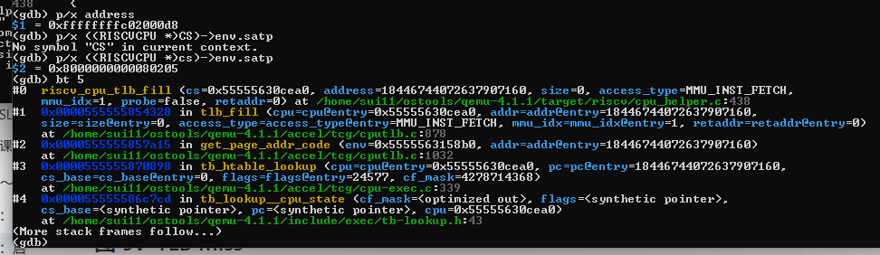
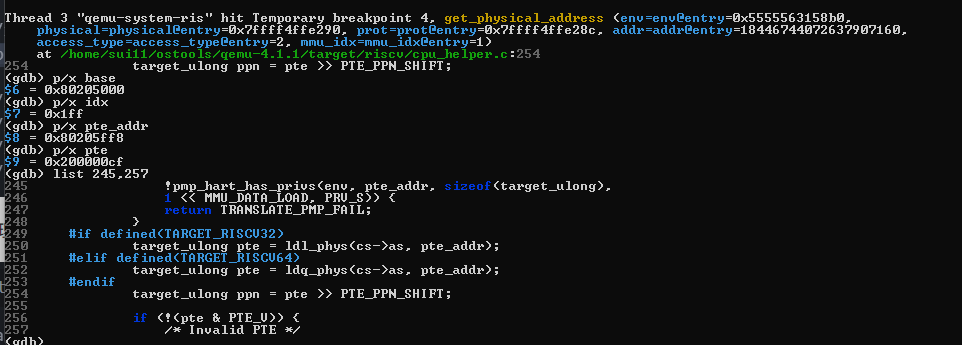
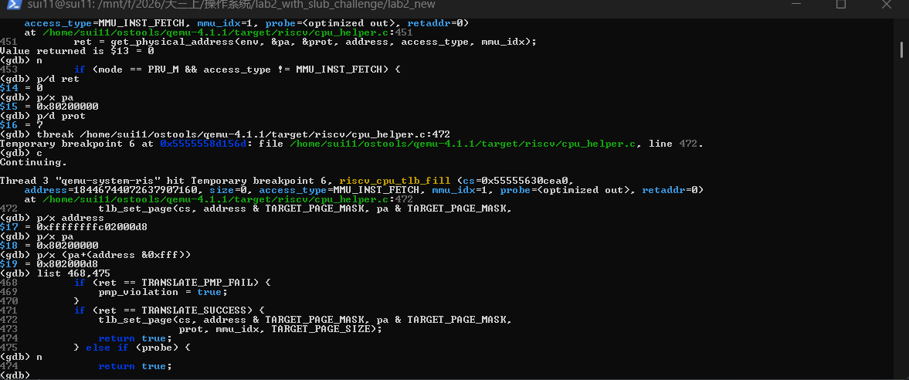
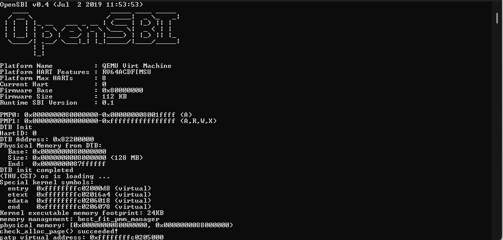
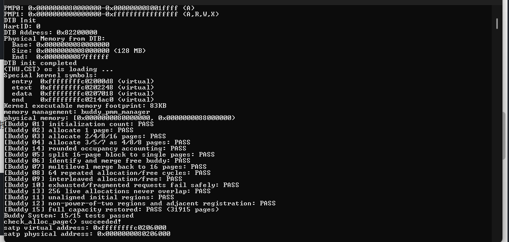
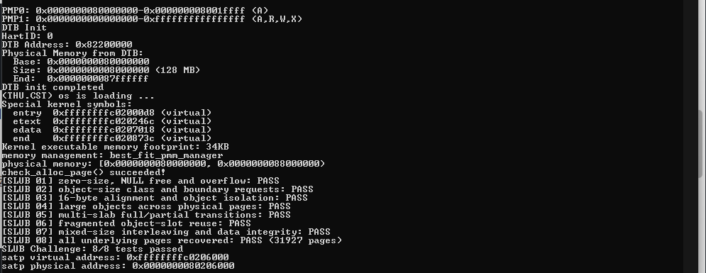
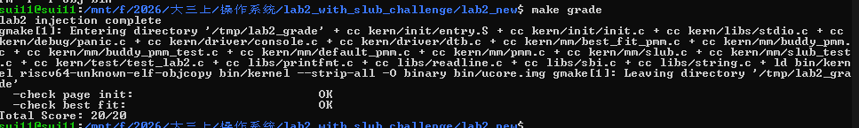

# 操作系统实验报告

## 实验基本信息

| 项目               | 内容                                           |
| ------------------ | ---------------------------------------------- |
| **实验名称** | Lab 2：物理内存和页表                          |
| **小组成员** | 2412950-路浩斌、2411865-王泽浩、2413771-罗裕城 |
| **完成日期** | 2026-10-26                                     |

### 小组分工

**练习如何分工？**

| 成员           | 负责的练习/模块                                                       |
| -------------- | --------------------------------------------------------------------- |
| 2412950-路浩斌 | 物理内存探测与 `page_init()`；QEMU GDB 页表查询调试；SLUB Challenge |
| 2411865-王泽浩 | First-Fit 源码阅读与分析；Best-Fit 页分配器实现；SLUB Challenge       |
| 2413771-罗裕城 | Buddy System 伙伴分配器及测试；SLUB Challenge                         |

**实验报告如何分工？**

路浩斌负责整理内存探测、页表原理和 GDB 调试记录；王泽浩负责 First-Fit、Best-Fit 的算法分析及页分配器验证；罗裕城负责 Buddy的实现说明与测试记录。三位成员共同完成 SLUB Challenge 拓展任务，共同检查实验目的、环境、测试截图和总结，统一整理报告。

---

## 一、实验目的

本实验的主要目的是：

1. 理解 RISC-V Sv39 分页机制，掌握虚拟地址、物理地址、页表项和物理页描述符之间的关系。
2. 学习内核如何通过设备树（DTB）获得物理内存范围，完成 `page_init()`，并为可用物理页建立管理信息。
3. 阅读 First-Fit 页分配算法，理解空闲块链表、连续页分配、块拆分及释放合并。
4. 实现 Best-Fit 分配策略，并通过原有接口和测试验证空闲块选择及状态维护是否正确。
5. 实现 Buddy System，理解按 2 的幂次管理物理页、逐级拆分和伙伴合并。
6. 完成 SLUB Challenge，理解页级分配器与对象级分配器的关系。
7. 使用 QEMU、GDB 和自动测试工具观察分页地址翻译及内存管理运行过程，学习在 AI 辅助开发中通过约束和测试验证结果。

---

## 二、实验环境

本组使用 RISC-V 64 位 uCore Lab2 工程。主要开发及运行环境沿用 Lab1，经本次 Lab2 实际使用的工具包括 Windows、WSL Ubuntu、VS Code、GNU Make、RISC-V 交叉编译工具链，以及带调试符号的 QEMU 4.1.1。内核运行使用 QEMU `virt` 机器和 OpenSBI；页表调试使用宿主机 GDB 与 `riscv64-unknown-elf-gdb` 两套调试器。

**AI 工具记录（按当前小组汇总整理，模型版本待逐人核实）**：

| 成员           | AI 编程工具                              | 底层模型  |
| -------------- | ---------------------------------------- | --------- |
| 2412950-路浩斌 | ChatGPT（网页端）、Codex（VS Code 插件） | GPT-6 Sol |
| 2411865-王泽浩 | ChatGPT（网页端）、Codex（VS Code 插件） | GPT-6 Sol |
| 2413771-罗裕城 | ChatGPT（网页端）、Codex（VS Code 插件） | GPT-6 Sol |

本次实验重点涉及 `kern/mm/pmm.c`、`kern/mm/default_pmm.c`、`kern/mm/best_fit_pmm.c`、`kern/mm/buddy_pmm.c`、`kern/mm/slub.c`、相关测试文件和 `kern/init/entry.S`。

---

## 三、实验整体逻辑分析

### 3.1 本章节的逻辑主线

Lab1 让最小内核能够正常启动，Lab2 则进一步解决内核如何认识、管理和使用物理内存的问题。即使设备树报告了某段 RAM，内核也不能直接把整个范围作为空闲内存使用，因为其中还包括固件、内核映像、页表和管理数据。

本实验的逻辑主线为：**从 DTB 获取物理内存范围 → 初始化物理页描述符并保留已占用内存 → 将可用页加入空闲块管理器 → 分配、释放与合并连续物理页 → 扩展 Buddy 和对象级 SLUB 分配 → 通过测试及 GDB 验证。**

uCore 使用 `struct Page` 描述每一个被管理的物理页。`Page` 本身不是 4 KiB 的实际物理页内容，而是包含引用计数、状态标志、空闲块大小及链表节点的元数据结构。`struct pmm_manager` 则把分配算法封装成统一接口，让上层通过 `alloc_pages()` 和 `free_pages()` 使用不同的物理页分配器。

Sv39 页表解决的是**虚拟地址如何映射到物理地址**，而 First-Fit、Best-Fit、Buddy 解决的是**哪些物理页可供分配**；SLUB 再在底层物理页之上提供更小粒度的对象分配。三者相互关联，但职责不同。

### 3.2 功能的逐步实现

1. **先理解原始内存布局与核心结构。** 阅读 `pmm.c`、`pmm.h`、`memlayout.h`、DTB 接口和双向链表，因为后续分配算法依赖它们。
2. **实现 `page_init()`。** 从 DTB 获取 RAM 范围，计算描述符数组位置，标记保留页并注册剩余空闲页，为后面的分配器提供可用内存。
3. **阅读 First-Fit。** 理解已有空闲链表如何初始化、查找、拆分、释放和合并，掌握 `property` 与 `nr_free` 的含义。
4. **实现 Best-Fit。** 在保持统一接口及官方测试不变的前提下，遍历所有候选空闲块，选取能够满足请求的最小块。
5. **新增 Buddy System。** 采用按阶空闲链表，完成块的逐级拆分和基于伙伴关系的合并，并编写独立检查。
6. **新增 SLUB Challenge。** 向底层页分配器申请物理页，再切分为对象槽位，支持小对象和较大对象的申请与回收。
7. **开展测试与页表调试。** 通过 `make qemu`、`make grade` 和条件编译测试验证功能，再用宿主机 GDB 观察 QEMU 的 Sv39 页表遍历和 TLB 填充过程。

---

## 四、实验内容与实现

### 功能模块：物理内存探测与 `page_init()`

**负责人：** 2412950-路浩斌

#### 模块功能描述

**需要实现/修改的函数：**

```c
static void page_init(void);  // kern/mm/pmm.c
```

**功能说明：**

内核启动时，DTB 已给出 RAM 的物理起始地址和大小。`page_init()` 使用这些信息确定可管理页范围，把内核末尾之后的合适区域用于存放 `struct Page` 描述符数组，先把页标记为保留，再把真正可用的完整物理页通过 `init_memmap()` 交给当前页分配器。

关键过程可以概括为：

```text
DTB 获取 memory_base、memory_size
    ↓
计算 memory_end、npage、nbase
    ↓
根据内核结束符号 end 安排 Page 描述符数组
    ↓
初始化 ref、flags、property、page_link
    ↓
跳过内核和描述符数组占用的页面
    ↓
init_memmap() 登记剩余的完整空闲页
```

其中 `pages[i]` 是页描述符，而不是页的实际内容；`npage` 表示管理范围的页号上界，不是空闲页数量。应利用 `ROUNDUP` 和 `ROUNDDOWN` 处理页对齐，防止把不足一页的尾部空间或已经占用的区域加入空闲链表。

**实际源码摘录：**

```c
static void page_init(void) {
    uint64_t base = get_memory_base();
    uint64_t size = get_memory_size();
    if (base != DRAM_BASE || size == 0 || size > ~(uint64_t)0 - base) {
        panic("invalid DTB memory range");
    }

    va_pa_offset = PHYSICAL_MEMORY_OFFSET;
    uint64_t memory_end = base + size;
    uintptr_t end_pa = memory_end < PHYSICAL_MEMORY_END
                           ? memory_end : PHYSICAL_MEMORY_END;
    end_pa = ROUNDDOWN(end_pa, PGSIZE);
    if (end_pa <= KERNEL_BEGIN_PADDR) {
        panic("RAM does not cover the kernel");
    }
    npage = PPN(end_pa);

    extern char end[];
    uintptr_t kernel_end_pa = PADDR(end);
    if (kernel_end_pa < KERNEL_BEGIN_PADDR || kernel_end_pa > end_pa) {
        panic("kernel is outside managed RAM");
    }

    size_t descriptor_count = npage - nbase;
    uintptr_t descriptor_pa = ROUNDUP(kernel_end_pa, PGSIZE);
    if (descriptor_pa > end_pa ||
        descriptor_count > (end_pa - descriptor_pa) / sizeof(struct Page)) {
        panic("insufficient RAM for page descriptors");
    }

    pages = (struct Page *)(descriptor_pa + va_pa_offset);
    for (size_t i = 0; i < descriptor_count; ++i) {
        pages[i].flags = 0;
        pages[i].property = 0;
        set_page_ref(&pages[i], 0);
        SetPageReserved(&pages[i]);
        list_init(&pages[i].page_link);
    }

    uintptr_t free_begin = ROUNDUP(
        descriptor_pa + descriptor_count * sizeof(struct Page), PGSIZE);
    cprintf("physical memory: [0x%016lx, 0x%016lx)\n", base, memory_end);
    if (free_begin < end_pa) {
        init_memmap(pa2page(free_begin), (end_pa - free_begin) / PGSIZE);
    }
}
```

此函数利用 DTB 提供的内存范围，限制实际管理边界，为整个物理页范围建立 `Page` 描述符，保留不可分配区域，并通过 `init_memmap()` 登记剩余完整页。

#### 独立 Spec：物理内存探测与 `page_init()`

| 项目         | 规格说明                                                                                                          |
| ------------ | ----------------------------------------------------------------------------------------------------------------- |
| 模块入口     | `static void page_init(void)`，由 `pmm_init()` 在管理器初始化后调用                                           |
| 输入来源     | `dtb_init()` 解析设备树得到的 RAM 基址和大小、框架定义的上界常量、内核链接符号 `end`                          |
| 前置条件     | 启动页表及直接映射可用；`pmm_manager` 已初始化；设备树解析结果可读取                                            |
| 主要后置条件 | `va_pa_offset`、`npage`、`pages` 设置正确；描述符完成初始化；可用完整页面交给 `init_memmap()`             |
| 核心不变量   | `nbase <= PPN(pa) < npage` 的描述符映射关系成立；所有登记为空闲的页面都位于内核、描述符数组之后，且地址按页对齐 |
| 错误处理     | RAM 信息不合法、发生地址溢出、内核或描述符区越界时 `panic()`；没有剩余完整页面时不调用 `init_memmap()`        |

**按情形验收：** 正常 128MiB RAM 能正确输出范围并登记空闲页；DTB 大小超过框架支持上界时只管理允许区间；资源不足与越界路径不能把内核镜像或 `Page` 元数据重新分配出去。`make grade` 中的 Page Init 检查和 `make qemu` 的内存打印是本次已有的运行证据。需要区分：当前实现主要处理课程提供的连续 RAM 场景，没有完整遍历所有设备树 `reserved-memory` 区域。

#### 最终提示词

**物理内存初始化 Prompt**：

````markdown
[PROMPT]

**任务：** 这是我们操作系统实验二的原始 uCore Lab2 代码框架。你先看一下指导书中“物理内存初始化”的要求，再结合项目里 `kern/mm/pmm.c`、`kern/driver/dtb.c`、`kern/mm/pmm.h` 和 `kern/mm/memlayout.h` 的实际定义，帮我完成物理内存初始化。主要是让内核能够根据 DTB 得到的物理内存范围建立 `Page` 描述符，并把真正可用的完整物理页交给当前内存管理器。这里要特别注意物理地址、虚拟地址、物理页号和 `Page *` 不是一个东西。

**操作要求：** 直接在项目文件中修改，不要只给示例代码。只补全 `kern/mm/pmm.c` 中 `//lab2 function1 YOUR CODE` 对应的实现位置；指导书没有要求修改的地方不要改。不要动设备树解析函数、框架的地址转换宏、已有测试和 `Makefile`。如果原框架中的名字和下面的描述有出入，先以真实源码为准核对，不要自己编一个接口。

**输出要求：** 修改完成后，告诉我实际改了什么、关键边界如何保证，并给出可以在 WSL 中运行的验证命令。不要为了让测试通过而修改测试代码。

[RELY]

从**原框架**核对并使用以下资源：

- 内存信息：`uint64_t get_memory_base(void)`、`uint64_t get_memory_size(void)`；`dtb_init()` 已在内核入口调用。
- 关键常量/宏：`DRAM_BASE`（本框架为 `0x80000000`）、`PGSIZE`（4096）、`PHYSICAL_MEMORY_END`（本框架为 `0x88000000`）、`PHYSICAL_MEMORY_OFFSET`、`KERNEL_BEGIN_PADDR`、`PPN`、`ROUNDUP`、`ROUNDDOWN`、`PADDR`。
- 已有全局状态：`struct Page *pages`、`size_t npage`、`const size_t nbase`、`uint64_t va_pa_offset`；`nbase = DRAM_BASE / PGSIZE`，`npage` 在本项目中是**物理页号上界**，不是空闲页数。
- `struct Page` 的实际字段为 `ref`、`flags`、`property`、`page_link`，可使用 `set_page_ref()`、`SetPageReserved()`、`list_init()`。
- 其他现有接口：`static void init_memmap(struct Page *base, size_t n)`、`pa2page()`、`panic()`、`cprintf()`、链接符号 `extern char end[]`。

[GUARANTEE]

必须补全并保留原签名：

```c
static void page_init(void);
```

已有的 `get_memory_base()`、`get_memory_size()`、`init_memmap()` 和 `pa2page()` 等只需要正确调用，不要重新实现，也不要改变其对外接口。

[SPECIFICATION]

### `page_init()`

**Pre-Condition：**
- 内核已经建立了本实验使用的直接映射环境，能够安全访问内核镜像和设备树。
- `dtb_init()` 已经执行，物理内存管理器已由 `init_pmm_manager()` 初始化。
- 输入内存范围由设备树提供，而不是直接写死成“全部 128MiB 都可分配”。

**Post-Condition：**
- `va_pa_offset` 与原框架的内核虚实地址直接映射关系一致。
- `npage` 表示不超过框架允许范围的**物理页号上界**；`pages` 指向正确放置并初始化的 `Page` 描述符数组。
- OpenSBI/启动保留范围、内核镜像和描述符数组占用的物理页不能进入空闲页管理器；只有完整且对齐的可用物理页才会注册给当前 `pmm_manager`。
- 能输出实际探测到的 RAM 范围；不会把 `Page *` 误当成真实物理页内容地址。

**Case 1：内存信息有效且存在可用页。** 应正确处理起始地址、上界和页对齐，完成描述符初始化，并恰好注册可用的连续页区间，不多登记也不少登记。

**Case 2：设备树提供的内存信息无效，或内核/描述符数组不在可管理范围内。** 应通过 `panic()` 终止初始化，不允许继续登记可能覆盖系统数据的页面。

**Case 3：RAM 大于框架支持的可管理范围。** 应限制管理上界，不应越过 `PHYSICAL_MEMORY_END` 对页面建立越界描述或进行分配。

**Case 4：排除已占用区域后，没有剩余的完整页。** 不调用 `init_memmap()`，不能把零页数或非完整页交给管理器。

**Requirements：** 不修改原框架的公共结构、页表、DTB 解析或测试逻辑；检查加法和数组空间计算的越界风险。完成后至少核对打印的 RAM 范围、`Page` 保留状态和官方 `page_init` 测试。
````

#### 实现迭代过程

##### 阶段一：先弄清楚原框架的数据含义

**实现思路：** 我们先阅读 `pmm.c`、DTB 和 `Page` 的定义，明确 `npage`、`PADDR(end)` 和 `pages` 的含义，并确定需要保留的内存范围。

**核对结果：** `dtb_init()` 在进入 `pmm_init()` 前已经完成，`get_memory_base()`/`get_memory_size()` 提供 RAM 范围。`npage` 保存物理页号上界，而描述符数应为 `npage-nbase`；链接符号 `end` 必须先做虚实地址转换。由此明确不能把整个 DTB RAM 范围直接注册为可用内存。

##### 阶段二：完成实现并检查边界

**实现范围：** 我们在 `page_init()` 中保留内核和 `Page` 数组占用的内存，再注册剩余的完整页面，并对不合法的 DTB 范围进行检查。

**对应修改：** 在 `page_init()` 中读取 `base/size`，检查零长度和地址溢出；根据 `PHYSICAL_MEMORY_END` 和 `ROUNDDOWN` 计算管理上界；通过 `PADDR(end)`、`ROUNDUP` 安排页描述符；逐个设置 `ref`、`flags`、`property`、`page_link`；从 `free_begin` 注册剩余空闲区。

**复查重点：** 描述符不能覆盖内核，也不能反过来被加入空闲列表；`free_begin` 必须页对齐；没有完整空闲页时不要调用 `init_memmap()`。

##### 阶段三：依据真实运行结果验收

**验证方式：** 在默认 Best-Fit 配置下运行 `make qemu` 并查看 DTB/RAM 输出、页管理器名称与 `check_alloc_page() succeeded!`；通过 `make grade` 单独检查 Page Init。

**实际结果：** RAM 范围为 `0x80000000～0x88000000`（128MiB），`make grade` 的 Page Init 检查为 `OK`。这说明已覆盖的正常初始化路径通过验证；无效 DTB/极端 RAM 大小属于规格中的异常分支。

---

### 练习：在未知物理内存范围的情况下，操作系统如何获取可用内存？

**负责人：** 2412950-路浩斌

当操作系统启动前不知道物理内存的实际地址范围时，不应简单地逐地址写入以探测 RAM，因为物理地址空间可能包含设备映射区（MMIO）、保留区及地址空洞。通常由引导固件或启动程序提供硬件内存布局信息。在本次 RISC-V QEMU 平台上，uCore 通过设备树（DTB）获得 RAM 的起始地址和大小，再通过 `page_init()` 排除内核和描述符数组占用的区域，得到真正可交给页分配器的连续空闲页。

因此，**探测到 RAM 范围不等于知道所有可分配页**：可分配范围还受到已占用内存、保留区域和页对齐条件的约束。

---

### 练习：阅读和分析 First-Fit 物理页分配算法

**负责人：** 2411865-王泽浩

原框架的 First-Fit 位于 `kern/mm/default_pmm.c`。

| 函数                             | 作用                                     |
| -------------------------------- | ---------------------------------------- |
| `default_init()`               | 初始化空闲链表头和空闲页计数             |
| `default_init_memmap(base, n)` | 把一段可用连续页登记为空闲块             |
| `default_alloc_pages(n)`       | 从链表头开始找到第一个足够大的块并分配   |
| `default_free_pages(base, n)`  | 回收页面、按地址插回链表并合并相邻空闲块 |

First-Fit 从 `free_list` 的第一个节点开始遍历，找到 `p->property >= n` 的块后立即停止搜索。若原块大于 n，就把剩余部分作为新的空闲块；释放时要判断前后空闲块与释放区是否在物理地址上连续，连续才合并。这里的 `nr_free` 是**全部空闲页数**，不是空闲块数量。

`page_link` 是嵌在 `Page` 中的双向链表节点，`le2page(le, page_link)` 可以由链表节点得到所在的 `Page`。空闲链表通常只链接各个**空闲块的头页**，不是每个空闲页都单独作为一个块头节点。

#### 阅读分析任务 Spec：First-Fit

- **初始化约定：** 空闲链表清空、空闲页数为零；登记时以头页 `property` 表示块长度，仅在链表中链接块头。
- **分配约定：** 从链表头扫描，第一个 `property >= n` 的块被选中；恰好满足则移除，过大则保留剩余块；失败返回 `NULL`。
- **回收约定：** 按物理地址插入，检查释放区与前后空闲块是否真实连续，更新 `property` 和 `nr_free`。
- **边界与局限：** `PageReserved=0`、`PageProperty=0` 不能单独证明某页一定空闲；原框架尾插分支存在潜在重复插入风险，阅读分析时指出，但本次按实验要求不修改原文件。

**验收方法：** 能用一组给定的空闲块现场推演 First-Fit 的首次命中、拆分、链表连接及双侧合并，并解释与 Best-Fit 的区别。

**改进空间：** First-Fit 可能反复从低地址扫描，最坏情况下需要查找全部空闲块，且分配与释放会造成外部碎片。可考虑 Next-Fit、按大小分级等方法，但需要权衡额外元数据和维护成本。

---

### 功能模块：Best-Fit 连续物理页分配器

**负责人：** 2411865-王泽浩

#### 模块功能描述

**需要实现/修改的函数：**

```c
static void best_fit_init(void);
static void best_fit_init_memmap(struct Page *base, size_t n);
static struct Page *best_fit_alloc_pages(size_t n);
static void best_fit_free_pages(struct Page *base, size_t n);
static size_t best_fit_nr_free_pages(void);
extern const struct pmm_manager best_fit_pmm_manager;
```

**功能说明：**

Best-Fit 的目标是在所有满足申请页数 n 的空闲块中，选择**长度最小的合适块**。与 First-Fit 不同，它不能找到第一个够用的块就停止，而是要比较候选块的 `property`。

**实际源码摘录：Best-Fit 分配函数（`kern/mm/best_fit_pmm.c`）**

```c
static struct Page *best_fit_alloc_pages(size_t n) {
    assert(n > 0);
    if (n > nr_free) {
        return NULL;
    }

    struct Page *best = NULL;
    for (list_entry_t *le = list_next(&free_list);
         le != &free_list; le = list_next(le)) {
        struct Page *p = le2page(le, page_link);
        if (p->property >= n &&
            (best == NULL || p->property < best->property)) {
            best = p;
        }
    }
    if (best == NULL) {
        return NULL;
    }

    size_t total = best->property;
    list_entry_t *prev = list_prev(&best->page_link);
    list_del(&best->page_link);
    ClearPageProperty(best);
    best->property = 0;
    if (total > n) {
        struct Page *remainder = best + n;
        remainder->property = total - n;
        SetPageProperty(remainder);
        list_add(prev, &remainder->page_link);
    }
    nr_free -= n;
    return best;
}
```

在这一实现中，`best` 始终保存目前找到的最小合适空闲块；找到后删除原块节点，必要时把 `remainder=best+n` 放回链表，并更新空闲页计数。

例如空闲块大小依次是 10、4、7 页，申请 3 页，First-Fit 选择 10 页块，而 Best-Fit 选择 4 页块。成功分配后将原块移出链表，必要时拆分剩余块，并使 `nr_free -= n`。释放时恢复相应 `Page` 状态，按物理地址顺序插入空闲块，并与前后物理连续的空闲块合并。

**关键不变量：** 空闲块之间不能重叠，空闲块头的 `property` 必须准确，且 `nr_free` 应等于各空闲块长度之和。默认使用哪个管理器由 `pmm.c` 中的 `init_pmm_manager()` 决定。

**实际源码摘录：Best-Fit 释放及前后合并**

```c
static void best_fit_free_pages(struct Page *base, size_t n) {
    assert(n > 0);
    for (struct Page *p = base; p < base + n; ++p) {
        assert(!PageReserved(p) && !PageProperty(p));
        p->flags = 0;
        p->property = 0;
        set_page_ref(p, 0);
    }
    base->property = n;
    SetPageProperty(base);
    nr_free += n;
    best_fit_insert_block(base);

    list_entry_t *prev = list_prev(&base->page_link);
    if (prev != &free_list) {
        struct Page *before = le2page(prev, page_link);
        if (before + before->property == base) {
            before->property += base->property;
            ClearPageProperty(base);
            base->property = 0;
            list_del(&base->page_link);
            base = before;
        }
    }

    list_entry_t *next = list_next(&base->page_link);
    if (next != &free_list) {
        struct Page *after = le2page(next, page_link);
        if (base + base->property == after) {
            base->property += after->property;
            ClearPageProperty(after);
            after->property = 0;
            list_del(&after->page_link);
        }
    }
}
```

源码先将释放区域按地址插入 `free_list`，再依次检查前一块、后一块的物理连续性。此处 `before + before->property == base` 等判断依据的是 `Page` 描述符数组中的连续位置。

#### 独立 Spec：Best-Fit 连续物理页分配

本模块的**规格目标**不是“能从链表中拿出任意可用页”，而是在保证物理页状态正确的同时，确实执行最佳适应策略。

| 函数/接口                        | 前置条件                                                              | 完成后必须满足的条件                                                                                                             |
| -------------------------------- | --------------------------------------------------------------------- | -------------------------------------------------------------------------------------------------------------------------------- |
| `best_fit_init()`              | 尚未开始登记空闲区                                                    | 建立合法的空链表，`nr_free=0`                                                                                                  |
| `best_fit_init_memmap(base,n)` | `n>0`，指定页段合法且处于保留状态                                   | 该页段变为合法空闲块，头页设置 `property=n`，页数计数增加 `n`                                                                |
| `best_fit_alloc_pages(n)`      | `n>0`，管理器已初始化                                               | 选择**所有可满足请求的块中最小的**；成功返回连续 `n` 页、拆分余块并减少 `nr_free`；无合适块则返回 `NULL`、不改变状态 |
| `best_fit_free_pages(base,n)`  | 待归还区间此前合法分配，非保留/非空闲块；兼容原测试的部分区间归还场景 | 恢复页状态，按物理地址插入；若与前、后块相邻则合并，计数增加 `n`                                                               |
| `best_fit_nr_free_pages()`     | 管理器已初始化                                                        | 返回当前所有空闲块的总**页数**，不是块数                                                                                   |
| `best_fit_pmm_manager`         | 现有接口与测试函数可用                                                | 注册上述函数并保留原 `best_fit_check()` 作为 `.check`                                                                        |

**状态不变量：** `nr_free == Σ(空闲块头.property)`；空闲块不重叠；一个空闲块只有一个合法头结点；链表双向指针一致，且按地址有序；分配过的页不能再次从空闲链表返回。

**必须区分的用例：** 对空闲块长度 10、5、8（链表依次排列）申请 4 页，Best-Fit 选 5 页块，而不是 First-Fit 的 10 页块。再覆盖“恰好分配”“拆分余块”“只有前/后邻居”“双侧合并”“总空闲足够但不连续”“零页请求违反前置条件”等情形。

**验收依据与修改边界：** 源码中实际完成最小候选比较，并通过 `basic_check()`、`best_fit_check()` 和官方 `make grade`；两个官方测试函数、`default_pmm.c`、`Makefile`、`grade.sh` 保持原样。当前实现的选择阶段需要扫描链表，最坏时间复杂度为 O(m)，这里的 m 是空闲块数。

#### 最终提示词

**Best-Fit 算法 Prompt**：

````markdown
[PROMPT]

**任务：** 现在我们已经了解 First-Fit 了。请你先对照指导书和 `kern/mm/default_pmm.c`，看看原来的空闲链表、分配和释放流程，再在 `kern/mm/best_fit_pmm.c` 中完成 Best-Fit。我要的不是把 First-Fit 简单改个名字，而是申请连续物理页时真正选择**所有可用空闲块中能够满足请求且长度最小的那一块**，释放后也要能正确恢复空闲链表。

**操作要求：** 直接修改仓库里的真实文件，只在 `best_fit_pmm.c` 中 `lab2 YOUR CODE` 对应区域补齐管理函数、私有状态和必要的 `static` 辅助函数。原文件后面的 `basic_check()`、`best_fit_check()` 是老师给的，**不要改**。`default_pmm.c`、`pmm.h`、`memlayout.h`、`libs/list.h`、`Makefile` 和 `grade.sh` 都保留原样。为了默认运行 Best-Fit，只允许在 `pmm.c` 的管理器选择位置作必要切换。

**输出要求：** 直接完成文件修改，给我说明每个函数实现的功能和与 First-Fit 的主要区别。编译和测试失败时分析实现问题，不要去改测试绕过断言。

[RELY]

- 原框架 `kern/mm/pmm.h` 中 `struct pmm_manager` 提供 `init`、`init_memmap`、`alloc_pages`、`free_pages`、`nr_free_pages`、`check` 函数指针。
- `struct Page` 含 `ref`、`flags`、`property`、`page_link`；空闲块头用 `PageProperty()`/`SetPageProperty()` 标记，块长记录在 `property` 中。
- `free_area_t` 含 `free_list`（双向循环链表头）和 `nr_free`（空闲**页数**），不是空闲块数量。
- 原有链表接口：`list_init`、`list_empty`、`list_next`、`list_prev`、`list_add`、`list_add_before`、`list_del`、`le2page`。
- 状态与检查接口：`PageReserved`、`PageProperty`、`ClearPageProperty`、`set_page_ref`、`assert`、`cprintf`。
- 参考 `default_pmm.c` 的 First-Fit 行为；`best_fit_pmm.c` 已经包含不可修改的 `basic_check()` 和 `best_fit_check()`。

[GUARANTEE]

必须实现并注册以下接口（名称、返回值、参数必须匹配原工程）：

```c
static void best_fit_init(void);
static void best_fit_init_memmap(struct Page *base, size_t n);
static struct Page *best_fit_alloc_pages(size_t n);
static void best_fit_free_pages(struct Page *base, size_t n);
static size_t best_fit_nr_free_pages(void);
const struct pmm_manager best_fit_pmm_manager;
```

其中 `best_fit_pmm_manager.check` 指向原文件已有的 `best_fit_check()`。如有必要，可以增加 `static` 的有序插入等辅助函数。还需在 `pmm.c` 中让默认分配器指向 `best_fit_pmm_manager`，但不得重写其他 PMM 框架逻辑。

[SPECIFICATION]

### `best_fit_init()`

**Pre-Condition：** 分配器尚未开始管理空闲物理页。

**Post-Condition：** 空闲链表为空，空闲页计数为零，后续可以注册可用内存。

### `best_fit_init_memmap(base, n)`

**Pre-Condition：** `n > 0`，`base` 指向一段合法且尚未交给其他分配操作使用的连续页描述符；初始化时该区域处于保留状态。

**Post-Condition：** 该区域成为一个合法空闲块；头页记录准确长度并设置相应标志；页引用状态、空闲链表和 `nr_free` 一致。

**Requirements：** 多块区域登记后，空闲链表的连接关系正确，节点不能被重复插入。应保留能支持相邻块判断的物理地址顺序，不丢失任何可用页。

### `best_fit_alloc_pages(n)`

**Pre-Condition：** `n > 0`，管理器已初始化。

**Post-Condition：** 成功时返回连续 `n` 页的起始 `Page *`，这些页不再属于空闲块；失败时返回 `NULL`，空闲链表及计数不变。

**Case 1：有多个满足请求的块。** 返回其中长度最小的一个块的起始页，而不是第一个满足条件的块；相同大小时可以维持原链表顺序选择。

**Case 2：选中块恰好等于请求大小。** 完整移出空闲块，不留下零长度块。

**Case 3：选中块大于请求大小。** 剩余的连续页仍然保存在合法空闲块中，不丢页、不重叠。

**Case 4：总空闲页不足或无足够长的连续块。** 返回 `NULL`，不修改管理状态。

### `best_fit_free_pages(base, n)`

**Pre-Condition：** `n > 0`，待释放区域是先前合法分配的连续物理页区域或其中允许单独归还的连续子区间；不是保留页或已登记的空闲块。

**Post-Condition：** 释放区域重新可用，空闲页数增加 `n`；相邻的空闲块能够合并为最大的连续区域；链表仍双向一致，块头标志和长度正确。

**Case 1：前后均不连续。** 新增一个独立空闲块。

**Case 2：只与前块或后块连续。** 正确合并成一个块。

**Case 3：同时与前后空闲块连续。** 最终合并成一个更大的连续块，不留下重复块头。

### `best_fit_nr_free_pages()` 与管理器注册

**Post-Condition：** `nr_free_pages()` 返回的值与所有空闲块长度之和一致；通过 `pmm_manager` 可调用所有管理函数和原有自检。

**Requirements：** 必须兼容原 `best_fit_check()` 中的部分区间释放场景。测试除原框架断言外，应能区分 First-Fit 与 Best-Fit，例如空闲块按链表顺序为 10、5、8 页时申请 4 页，应选 5 页块。
````

#### 实现迭代过程

##### 阶段一：从 First-Fit 明确要修改的行为

**实现思路：** 开始实现 Best-Fit 时，我们先阅读 `default_pmm.c` 中的 First-Fit，重点比较两种算法的空闲块选择方式，再在保留原测试函数的前提下实现分配、拆分和回收功能。

**分析：** First-Fit 在 `p->property >= n` 时立即 `break`；Best-Fit 应遍历所有能满足请求的块，持续更新当前最小候选。同时初始化、拆分、回收和 `pmm_manager` 注册都必须满足原框架接口约定。

**完成的修改：** 在指定区域新增 `best_fit_init()`、`best_fit_init_memmap()`、`best_fit_alloc_pages()`、`best_fit_free_pages()`、`best_fit_nr_free_pages()` 和管理器注册结构；默认管理器选为 Best-Fit。未修改 `basic_check()` 和 `best_fit_check()`。

##### 阶段二：针对链表尾部插入问题修改实现

**遇到的问题：** 早期实现沿用链表遍历分支，末尾插入新空闲块后没有立即停止，可能继续处理新节点，破坏 `prev/next` 对应关系。

**问题分析：** 双向循环链表要求任何节点满足 `node->next->prev == node` 和 `node->prev->next == node`。一个已经插入链表的节点如果再次参与插入，容易导致链表结构损坏，进一步引起重复分配或遍历异常。

**调整方法：** 我们将 Best-Fit 的插入逻辑封装为 `best_fit_insert_block()`：先按物理地址遍历到第一个不小于 `base` 的节点，再只调用一次 `list_add_before()`。初始化登记和释放路径都复用这个辅助函数；释放后再检查前后物理块是否连续并合并。

##### 阶段三：增加可区分算法的检查，再核对运行结果

**检查内容：** 除了检查 `alloc_pages()` 的返回值，还比较所选空闲块的大小：当空闲块大小按链表顺序为 10、5、8 页、申请 4 页时，Best-Fit 应选 5 页块。同时检查余块 `property`、空闲页总数、双侧合并和无连续大块时返回 `NULL` 的情况。

**实际验证：** 原框架 `basic_check()` 和 `best_fit_check()` 保持不变；本次 `make qemu` 截图出现 `memory management: best_fit_pmm_manager` 与 `check_alloc_page() succeeded!`，`make grade` 的 Best-Fit 检查为 `OK`。这能证明指定测试通过，但并不能替代对所有边界状态的穷尽验证。

**思考题：Best-Fit 还能怎样改进？** 目前链表扫描最坏为 O(m)，m 为当前空闲块数。后续可以按大小建立分类表或平衡树以减少查找开销，但仍需要支持按物理地址合并，且小余块产生的外部碎片不能完全避免。

---

### 功能模块：Buddy System 伙伴分配器

**负责人：** 2413771-罗裕城

#### 模块功能描述

**需要新增/修改的函数：**

```c
static void buddy_init(void);
static void buddy_init_memmap(struct Page *base, size_t n);
static struct Page *buddy_alloc_pages(size_t n);
static void buddy_free_pages(struct Page *base, size_t n);
static size_t buddy_nr_free_pages(void);
static void buddy_check(void);
extern const struct pmm_manager buddy_pmm_manager;
```

**功能说明：**

Buddy 按阶数管理连续物理页，`order=k` 对应 `2^k` 页大小的块。申请 3 页时实际分配一个 4 页块；若对应阶的空闲链表没有可用块，就从更高阶取块并反复一分为二。释放时计算同阶伙伴的位置，如果伙伴也空闲并且合法，就合并成更高阶块，继续尝试合并。

典型伙伴定位关系为：

**实际源码摘录：请求页数换算为阶数（`kern/mm/buddy_pmm.c`）**

```c
static int request_order(size_t n) {
    if (n == 0 || n > ((size_t)1 << BUDDY_MAX_ORDER)) { // 先限制范围，防止移位或取整溢出
        return -1; // 不可表示的请求交给调用者处理
    }
    int order = 0; // 从单页块开始寻找
    while (((size_t)1 << order) < n) { // 直到块能覆盖请求的所有页
        order++; // 每升一阶，块大小翻倍
    }
    return order; // 例如 n=3 返回 2，即 4 页
}
```

**实际源码摘录：利用 XOR 查找空闲伙伴并尝试向上合并**

```c
static void release_block(struct Page *base, int order) {
    size_t ppn = page2ppn(base); // 使用物理页号，而非相对可用区起点的偏移
    while (order < BUDDY_MAX_ORDER) { // 顶阶不能再扩大
        size_t span = (size_t)1 << order; // 当前块包含的页数
        size_t other_ppn = ppn ^ span; // 翻转此阶对应位得到唯一伙伴
        if (other_ppn < nbase || other_ppn >= npage || span > npage - other_ppn) { // 短路判断保护下界和末尾
            break; // 伙伴超出管理范围时保留当前块
        }
        struct Page *other = pages + (other_ppn - nbase); // 边界确认后才构造描述符指针
        if (!PageProperty(other) || PageReserved(other) || other->property != span) { // 空闲但不同阶也不能合并
            break; // 伙伴正被使用、未注册或已被更大块包含
        }
        list_del(&other->page_link); // 先摘除伙伴旧节点，防止一块内存存在于两个阶中
        ClearPageProperty(other); // 原伙伴头现在可能变为合并块的内部页
        other->property = 0; // 清除过期长度，辅助排查状态错误
        if (other_ppn < ppn) { // 合并块必须从两个伙伴中较低的地址开始
            base = other; // 更新描述符块头
            ppn = other_ppn; // 同步更新下一轮 XOR 使用的页号
        }
        order++; // 两个同阶块合成一个高阶块
    }
    insert_block(base, order); // 不能继续合并时，只有最终块头进入链表
}
```

相邻空闲块并不一定是伙伴；必须同阶、均空闲且满足伙伴地址与对齐关系。实际实现需要检查管理范围及块状态，不能只根据异或得到的编号直接合并。

Buddy System 采用独立模块实现，包括 `buddy_pmm.c`、`buddy_pmm.h` 和 `buddy_pmm_test.c`。默认情况下内核使用 Best-Fit，通过定义 `LAB2_USE_BUDDY` 可以切换到 Buddy 进行测试。相关测试覆盖按阶分配、非幂次申请、拆分、合并、边界及页数统计。

**代码核对：** `buddy_alloc_pages()` 从目标阶向高阶查找，拆分时把右半块放回对应空闲链表；`buddy_free_pages()` 校验原申请和整笔释放，再调用 `release_block()`。

#### 独立 Spec：Buddy 分配器与独立测试

**A. 分配器 Spec（`buddy_pmm.c`、`buddy_pmm.h`）**

| 条目         | 行为规格                                                                                                                    |
| ------------ | --------------------------------------------------------------------------------------------------------------------------- |
| 接口         | 通过 `buddy_pmm_manager` 实现 `init`、`init_memmap`、`alloc_pages`、`free_pages`、`nr_free_pages`、`check`    |
| 输入与初始化 | 从 `page_init()` 接收合法连续物理页描述符区间，可处理非 2 的幂长度和非大块对齐起点                                        |
| 分配后置条件 | 请求 `n` 页时取 `2^ceil(log2 n)` 的合法块；成功时内存连续、按阶对齐、实际占用页不重叠；失败返回 `NULL` 且状态不被破坏 |
| 释放前置条件 | `base` 为活动分配块头，`n` 与原始请求一致；**采用整笔释放约定**，不支持任意子块拆开归还                           |
| 释放后置条件 | 将实际占用页归还，寻找同阶、同一父块的空闲伙伴并逐级合并；统计按实际占用页数变化                                            |
| 伙伴与边界   | 伙伴起始 PPN=`ppn ^ (1 << order)`；还需验证合法范围、空闲标志、同阶长度及对齐关系，不能单靠地址相邻合并                   |
| 接入限制     | 不改变 `Page`、`pmm_manager` 公共结构；默认 Best-Fit，只有定义 `LAB2_USE_BUDDY` 才启用 Buddy                          |

**B. 测试 Spec（`buddy_pmm_test.c`）**

- **前置条件：** Buddy 已初始化；测试使用与系统其他可用内存隔离的区域，不能任意重置正在使用的外层分配状态。
- **成功后置条件：** 测试空间没有活动页泄漏；每个测试块和每阶空闲链表均满足容量、对齐、不重叠的约束；最终真实空闲页数量恢复。
- **至少覆盖：** 1/2/4/8/16 页，3/5/7 页取整，逐级拆分、左右伙伴和多级合并，64 轮交错操作，耗尽与碎片化，非对齐起点，19/27 页登记，相邻区域分批登记及最多 256 个活动单页不重叠。
- **独立判据：** 使用 `occupied[]` 记录活动分配、`expected_free` 计算页数；断言失败就终止测试，不能仅凭打印 PASS 判定成功。

**验收依据：** 本组 QEMU 截图显示 `Buddy System: 15/15 tests passed`；运行的是条件编译后的 Buddy 管理器，而非默认 Best-Fit。

#### 最终提示词

**Buddy 算法实现 Prompt**：

````markdown
[PROMPT]

**任务：** 这是我们 Lab2 的必做 Buddy System，原框架并没有现成实现。你先结合指导书看一下 `pmm_manager` 和 `Page` 的接口，再帮我新建伙伴系统分配模块。它要能管理 2 的幂次大小的物理页块，支持非 2 的幂次申请、拆分和按伙伴关系回收合并。之前实现的 Best-Fit 仍然要能正常使用。

**操作要求：** 需要的话新建 `kern/mm/buddy_pmm.c` 和 `buddy_pmm.h`，在仓库中直接写入实际代码。只在 `pmm.c` 的分配器选择位置增加最小的接入修改，默认仍使用 Best-Fit，通过 `LAB2_USE_BUDDY` 宏才选择 Buddy。指导书没有要求改的原框架文件不要动，尤其不要改 `Makefile`、`grade.sh`、First-Fit 源码和 Best-Fit 官方测试函数。这个 Prompt 只负责算法模块；独立测试文件我会在下一份 Prompt 中单独要求实现。

**输出要求：** 说明模块增加了哪些文件和接口、有哪些边界条件，告诉我怎样切换并验证 Buddy。不要使用用户态 `malloc()` 等原内核不具备的接口。

[RELY]

- 原框架 `struct pmm_manager` 包含 `init`、`init_memmap`、`alloc_pages`、`free_pages`、`nr_free_pages`、`check`。
- `struct Page` 的 `property`、`flags`、`page_link` 可用于存放块大小、空闲/分配状态及链表节点；`ref` 可由 `set_page_ref()` 初始化。
- 全局页布局来自 `pages`、`nbase`、`npage`；可使用 `page2ppn()`、`pa2page()` 和 `PageReserved`、`PageProperty`、`SetPageProperty`、`ClearPageProperty`。
- 可用双向循环链表接口在 `libs/list.h`；调试使用 `assert()`、`cprintf()`，不可使用普通用户态内存分配库。
- 本实验单页为 `PGSIZE`（4096 字节）；物理页号与 `Page *` 数组下标有 `nbase` 偏移，伙伴对齐应依据**实际物理页号**。

[GUARANTEE]

新模块至少要完成：

```c
static void buddy_init(void);
static void buddy_init_memmap(struct Page *base, size_t n);
static struct Page *buddy_alloc_pages(size_t n);
static void buddy_free_pages(struct Page *base, size_t n);
static size_t buddy_nr_free_pages(void);
static void buddy_check(void);
const struct pmm_manager buddy_pmm_manager;
```

`buddy_pmm.h` 要声明 `extern const struct pmm_manager buddy_pmm_manager;`。允许添加仅在模块内部使用的 `static` 辅助函数和按阶链表。自检入口应与下一份 Prompt 的独立测试模块衔接，最终由 `buddy_pmm_manager.check` 调用。

[SPECIFICATION]

### `buddy_init()` 与 `buddy_init_memmap(base, n)`

**Pre-Condition：** 管理器先初始化；`init_memmap` 的 `base` 指向合法且尚未登记的物理页描述符区间，`n > 0`。

**Post-Condition：** 可用区域被准确表示为若干合法的 2 的幂次块，每一块按自身大小对齐、各块互不重叠；所有可用页被覆盖且不越过 RAM 边界；初始空闲页计数等于登记的完整页数。

**Case 1：起点和总页数恰好满足大块对齐。** 可以组成对应的大块。

**Case 2：起点不对齐或长度不是 2 的幂。** 仍应将区域完整划分为合法的小块，不丢页、不占用区间以外的保留页。

### `buddy_alloc_pages(n)`

**Pre-Condition：** 分配器已初始化，请求以物理页为单位。

**Post-Condition：** 成功时返回满足请求的连续块头，实际占用大小为不小于 `n` 的最小 2 的幂；块地址符合该阶对齐要求，所有实际占用页面不再被其他申请得到。

**Case 1：`n` 是合法的 2 的幂。** 分配对应大小的块。

**Case 2：`n` 不是 2 的幂。** 正确向上取整，例如申请 3 页实际占 4 页，申请 5 页实际占 8 页；空闲页统计按**实际占用块长度**扣除。

**Case 3：目标阶暂时没有空闲块，但更高阶有。** 能从更高阶获得合法块并保留未被占用的部分。

**Case 4：申请为 0、超出本模块支持范围或无可满足的块。** 返回 `NULL`，不破坏原有空闲块和计数。

### `buddy_free_pages(base, n)`

**Pre-Condition：** `base` 是本管理器先前返回的活动块头，`n` 为**原申请页数**，采用整笔释放，不支持把一笔 Buddy 申请拆成多次任意子区间释放。

**Post-Condition：** 归还整个按 2 的幂次取整后的块；若满足伙伴条件，则尽可能向上合并；最终每个空闲块只登记一次，实际空闲页数准确恢复。

**Case 1：伙伴正在使用、属于保留区或不属于同一阶。** 不合并，不影响其他活动块。

**Case 2：同阶伙伴空闲且是真正配对的伙伴。** 合并成更高阶块，并继续检查是否还能合并。

**Requirements：** 伙伴关系必须基于实际物理页号及阶数判断，不能把任意相邻块当作伙伴；对越界、错误块头或不匹配的释放请求进行必要断言检查。本实验按单核教学环境设计，不自行修改原框架并发或中断系统。

### `buddy_nr_free_pages()`、`buddy_check()` 和选择器

**Post-Condition：** `nr_free_pages` 返回能够再次分配的完整空闲物理页数；管理器注册完整，通过选择宏能够正确切换到 Buddy，而不改变默认 Best-Fit 的行为。

**Requirements：** 后续独立测试应能验证块不重叠、对齐、容量守恒和递归合并；不要通过关闭断言或修改公共测试来实现通过。
````

**Buddy 测试设计 Prompt**：

````markdown
[PROMPT]

**任务：** Buddy 分配器已经写好了，接下来按指导书要求再单独设计一份测试。你先看一下我们实际实现的 `buddy_pmm.c`、`buddy_pmm.h`，别重新写一套分配算法。我希望测试不仅能申请成功，还能发现拆分、伙伴合并、页数统计、重复占用和边界处理方面的问题。最好能在 QEMU 中直接看见每类测试通过的结果。

**操作要求：** 直接新建 `kern/mm/buddy_pmm_test.c`，必要时仅在 Buddy 自己的源码/头文件中增加测试入口和最小接线。不要修改 `basic_check()`、`best_fit_check()`、`default_pmm.c`、`grade.sh` 和 `Makefile`。测试必须调用真实的 `buddy_pmm_manager` 函数表，不允许在测试里复制或重写分配实现。测试不能在结束时用重置管理器的方式掩盖仍未释放的块。

**输出要求：** 把测试代码写入项目，列出每个测试场景为什么要测、用什么断言验证，以及失败时可能对应哪个算法问题。最终运行时用 `cprintf` 打印清楚分项结果，但打印 PASS 的前提必须是相应断言已经执行通过。

[RELY]

- 已有 Buddy 实现提供 `buddy_pmm_manager.init`、`.init_memmap`、`.alloc_pages`、`.free_pages`、`.nr_free_pages`、`.check`。
- `struct Page`、`page2ppn()`、`PageReserved()`、`PageProperty()`、`set_page_ref()`、`list_init()` 用于验证描述符与边界状态。
- 使用内核的 `assert()`、`cprintf()`、`memset()` 等接口；不能依赖用户态标准测试框架。
- 申请 `n` 页后实际占用 `round_up_pow2(n)` 页，释放时向 Buddy 传回**原申请页数**。
- 为避免破坏真实系统空闲链表，测试应使用已独占取得的连续页面形成隔离测试区域，并在测试前后核对和恢复外部状态；大测试记录不要压到内核有限的启动栈上。

[GUARANTEE]

必须提供一个由 Buddy 自检入口调用的独立测试函数：

```c
void buddy_run_tests(struct Page *arena, void (*verify)(void));
```

并确保 Buddy 模块实际实现并注册：

```c
static void buddy_check(void);
```

测试模块允许使用 `static` 辅助函数分别组织分配、释放和校验，但不要新增不必要的公开接口。

[SPECIFICATION]

### `buddy_run_tests(arena, verify)`

**Pre-Condition：** `arena` 指向由外层 Buddy 自检独占并隔离的连续测试页区域；测试开始前管理器和校验回调已经准备好。

**Post-Condition：** 所有测试成功后，无测试用活动申请遗留；测试区域内的空闲页数量恢复预期，块边界正确，不与区域外内存重叠；每类检查完成后有可识别的输出。

**Case 1：常见分配大小。** 测试 1、2、4、8、16 页及 3、5、7 页，检查向上取整、地址对齐和实际扣除页数。

**Case 2：块拆分与伙伴合并。** 将 16 页大块拆成多个单页块，再按照可触发不同合并层次的顺序释放，最终应能重新获得完整的 16 页块。

**Case 3：连续多轮申请与释放。** 重复进行至少 64 轮交错分配、释放，验证状态在多轮操作后保持一致。

**Case 4：内存耗尽和碎片化。** 耗尽测试区后继续申请应返回 `NULL`；虽然空闲总页数足够但缺少合法连续伙伴块时，也不能错误地返回已有分配页。

**Case 5：非对齐及非 2 的幂次初始区域。** 测试起点有偏移、长度为 19/27 等场景，以及相邻区域分批注册后的管理结果；不得分配区域外的保留页。

**Case 6：分配重叠与容量恢复。** 保持大量活动申请同时存在，验证任何两个实际占用块（包括取整后的填充页）均不重叠；最终释放全部对象后空闲页总数与测试前一致。

**Requirements：** 测试程序要独立维护 `occupied[]` / `expected_free` 等预期状态，不直接相信被测实现记录的占用信息；每次分配和回收后适当调用 `verify()` 检查多阶链表一致性。无效释放属于断言失败类场景，不要让正常的全量自检故意触发 panic 后中断整组测试。正常通过时输出类似 `Buddy System: 15/15 tests passed` 的汇总，但实际编号必须对应执行过的断言。

### `buddy_check()`

**Pre-Condition：** 真实内存管理器已完成初始化，并由 `pmm_manager->check()` 调用。

**Post-Condition：** 为 `buddy_run_tests` 准备安全的隔离测试空间；测试结束后真实物理内存管理状态及空闲页总数恢复原值；失败时通过断言暴露问题。

**Requirements：** 不允许让测试重置或破坏外层仍在使用的空闲链表；不得用“只打印 PASS”代替实际断言。
````

#### 实现迭代过程

##### 阶段一：明确 Buddy 与已有页管理器的关系

**实现思路：** 我们先明确 Buddy 与 Best-Fit 的接口关系，以及块和页的对应关系，再实现按阶分配，并检查申请 3 页时按 4 页分配的取整规则。

**分析：** Buddy 与 Best-Fit 是两个可替换的页分配策略，都通过 `pmm_manager` 接口接入，不能在同一次分配中共同管理相同空闲页。Buddy 以 `2^order` 页为一块，取整后的完整块都属于本次申请，不能把内部多出的页误算为仍然空闲。

**形成的实现：** 新增 `buddy_pmm.c/.h`、按阶空闲链表和 `request_order()`； `buddy_init_memmap()` 把实际可用区划分成合法且对齐的块；分配时从目标阶向上查找并逐级拆分；释放时根据实际 PPN 使用 `ppn ^ span` 找伙伴，再检查范围、标志和大小是否匹配。

##### 阶段二：针对核心边界和接口约定复查

**检查内容：** 我们重点检查异或运算查找左右伙伴的原理、相邻块的合并条件，以及非 2 的幂次申请在释放时的页数统计。

**处理方式：** 合法伙伴只有同阶、同一父块拆分得到的两个对齐块。`ppn ^ (1 << order)` 可在左右伙伴间切换，但得到地址后仍必须检查管理范围及空闲状态。申请 3 页的实际占用是 4 页，释放时也归还 4 页；该实现还在块头记录原始请求 `n`，要求 `free_pages(base,n)` 整笔释放。

**本阶段防范的风险：** 非对齐起始内存区间划分错误、两个相邻但非伙伴的块被合并、同一页重复分配，以及申请失败后破坏空闲链表。

##### 阶段三：单独设计测试，不用算法自身的结果当唯一标准

**测试思路：** 测试覆盖拆分、合并、碎片化、反复申请和内存耗尽，并独立记录活动页，检查是否存在重复分配。

**对应修改：** 新增 `buddy_pmm_test.c`，通过 `occupied[]` 独立记录活动页、用 `expected_free` 记录预期容量，并在关键操作后调用状态校验。场景包含 1/2/4/8/16 页、3/5/7 页取整、16 页拆分合并、64 轮循环、耗尽与碎片化、非对齐区间及相邻分批登记。

**验证结果：** 本次 QEMU 运行截图为 `Buddy System: 15/15 tests passed`，同时有 `check_alloc_page() succeeded!`。运行使用 `make clean` 后的 `LAB2_USE_BUDDY` 编译配置，不是默认 Best-Fit 的测试结果。

---

### Challenge：SLUB 小对象内存分配

**参与成员：** 2412950-路浩斌、2411865-王泽浩、2413771-罗裕城（小组共同完成）。

**需要新增/修改的函数：**

```c
void slub_init(void);
void *slub_alloc(size_t size);
void slub_free(void *ptr);
void slub_check(void);
```

**功能说明：**

物理页分配器以 4 KiB 页为单位分配内存，如果每次申请几十字节都独占一页，会造成浪费。本项目SLUB 在底层页分配器上增加对象分配层：按申请大小选取合适的对象缓存，将获得的物理页切分为多个固定大小的槽位，并用空闲对象链表管理。

本实现的小对象类别为 **16、32、64、128、256、512、1024、2048 字节**。例如申请 24 字节，选择 32 字节缓存。Slab 内部的 `free_head` 指向空闲槽链表；`inuse` 记录正在使用的对象数量，`partial` / `full` 链表管理尚有空槽和已满的 Slab。超过 2048 字节的对象走连续页分配路径，并记录释放所需的页数信息。

分配小对象时，优先从已有的部分空闲 Slab 中取槽位；没有可用 Slab 时申请一个物理页并划分槽位。释放对象时把槽位交回对应 Slab，必要时从 `full` 移回 `partial`；整页已无活动对象时，按策略把底层物理页释放。

**实际源码摘录：SLUB 小对象分配（`kern/mm/slub.c`）**

```c
static void *slub_alloc_small(unsigned int index) {
    struct slub_cache *cache = &slub_caches[index];
    if (list_empty(&cache->partial) && slub_new_slab(index) == NULL) {
        return NULL;
    }
    struct slub_slab *slab = to_struct(list_next(&cache->partial),
                                       struct slub_slab, link);
    assert(slab->magic == SLUB_SLAB_MAGIC);
    assert(slab->cache_index == index && slab->inuse < slab->capacity);
    void *object = slab->free_head;
    assert(object != NULL);
    uintptr_t offset = (uintptr_t)object -
                       ((uintptr_t)slab + SLUB_OBJECT_START);
    assert(offset % cache->object_size == 0);
    size_t slot_index = offset / cache->object_size;
    assert(slot_index < slab->capacity);
    assert(!slub_bitmap_is_set(slab, slot_index));

    slab->free_head = *(void **)object;
    slub_bitmap_set(slab, slot_index);
    ++slab->inuse;
    if (slab->inuse == slab->capacity) {
        assert(slab->free_head == NULL);
        list_del(&slab->link);
        list_add(&cache->full, &slab->link);
    }
    return object;
}
```

这段代码直接从源码提取：先查 `partial` 链表，没有可用 Slab 就创建新 Slab；取出 `free_head` 指向的对象槽，更新位图和 `inuse`，满额时转移到 `full` 链表。释放接口 `slub_free()` 则负责空闲槽回收、位图校验以及整个 Slab 空闲时归还物理页。

#### 独立 Spec：SLUB 对象分配器与测试

**A. 分配器 Spec（`slub.c`、`slub.h`）**

| 接口                            | 输入及前置条件                              | 后置条件与边界情况                                                                                                                             |
| ------------------------------- | ------------------------------------------- | ---------------------------------------------------------------------------------------------------------------------------------------------- |
| `slub_init()`                 | 底层页分配器已初始化，当前未初始化 SLUB     | 设置 16、32、64、128、256、512、1024、2048 字节缓存和 `partial/full` 空链表，不预先无故申请物理页                                            |
| `slub_alloc(size)`            | 已初始化；`size` 单位是**字节**     | `size=0` 返回 `NULL`；小对象进入满足大小的最小缓存类别；若现有 slab 有空槽则复用，否则申请新页；结果至少能容纳 `size` 字节且 16 字节对齐 |
| `slub_alloc(size)` 大对象路径 | `size>2048`                               | 向底层申请足够的连续物理页并记录页数；超过 2048 不意味着必然超过一页；计算溢出或分配失败返回 `NULL`                                          |
| `slub_free(ptr)`              | `ptr=NULL` 或尚未释放的合法 SLUB 对象指针 | `NULL` 不操作；小对象归还槽并更新位图、`inuse` 和 `partial/full`；整张 slab 空闲时归还完整页；大对象按元数据归还完整连续页               |
| `slub_check()`                | 底层和 SLUB 已完成初始化                    | 执行真实对象申请、写入、回读、回收检查，通过断言验证结果                                                                                       |

**结构不变量：** Cache 按对象类别区分；`partial` 只含未满的 slab、`full` 只含满 slab；一个对象槽被分配时不出现在空闲链表；`allocated` 位图与 `inuse` 一致；活动对象的有效数据区不重叠；整个 slab 空闲时其底层页面可再次被分配。

**B. 独立测试 Spec（`slub_test.c`）**

- **前置条件：** 无本轮遗留对象；记录测试开始时的 `nr_free_pages()`。
- **必须覆盖：** 0 字节与 `free(NULL)`；16/17/32/33/2048/2049 等类别边界；16 字节对齐；多活动对象数据不互相覆盖；4096、4097、8192 等多页对象；至少 400 个 16 字节对象跨多个 slab；释放后槽位复用；混合大小交错释放；极大尺寸溢出处理。
- **完成条件：** 所有活动测试对象均释放，`nr_free_pages()` 回到初值；测试通过 `assert()` 检查，只有所有检查通过后才输出成功信息。
- **资源与范围：** 大型测试数组放静态存储区，避免超出内核栈；实验以单核、无并发分配的教学场景为前提，不要求 Linux 完整的 per-CPU/NUMA 机制。

**验收依据：** 本次 QEMU 截图显示 `SLUB Challenge: 8/8 tests passed`，并显示 `31927 pages` 已恢复；

**最终提示词**：

**SLUB 算法实现 Prompt**：

````markdown
[PROMPT]

**任务：** 现在 Lab2 的页级分配器已经有 Best-Fit 和 Buddy 了，我还想把指导书中 SLUB 的拓展任务也完成。请你先看现有 `pmm.h`、`memlayout.h` 和页分配接口，再新增一个简化的 SLUB 对象分配器。它不是再实现一次 Best-Fit，而是利用底层分配器申请物理页，然后在页里面给几十字节到几千字节的对象分配内存。实现要体现指导书要求的“两层架构”，同时尽量适合我们现在这个裸机 uCore 环境。

**操作要求：** 直接在项目中新增 `kern/mm/slub.c` 和 `slub.h`，不要只发示例。为选择性运行拓展测试，可以在 `pmm.c` 的 PMM 初始化完成之后增加 `LAB2_USE_SLUB` 控制的最小测试入口。指导书不要求修改的原框架文件不要改，包括原始 `Page`、First-Fit、Best-Fit 测试、`Makefile` 和 `grade.sh`。SLUB 的测试我会用下一份 Prompt 单独生成，这里重点完成真实的对象分配模块。

**输出要求：** 先对照工程确认每个 API 的返回值和地址含义，再修改文件。完成后解释一个 24 字节小对象如何分配和释放，以及一个 6000 字节大对象如何处理。不要使用 `malloc()` 等用户态接口。

[RELY]

- 底层页管理 API：`struct Page *alloc_pages(size_t n)`、`void free_pages(struct Page *base, size_t n)`、`size_t nr_free_pages(void)`，以及 `alloc_page()`/`free_page()` 宏。
- 地址转换：`page2pa(struct Page *)` 返回物理地址；内核直接映射区地址为 `page2pa(page) + va_pa_offset`；可用 `pa2page()` 将合法物理地址转换回描述符。
- 原有页面大小：`PGSIZE=4096`；内核 `struct Page` 是元数据，不是页面的字节缓冲区。
- 可用链表接口：`list_entry_t`、`list_init()`、`list_add()`、`list_del()`、`list_empty()`、`to_struct()`。
- 可用支持函数：`memset()`、`assert()`、`cprintf()`、`ROUNDUP` / `ROUNDDOWN`、`uintptr_t`、`size_t`。
- 当前实验适用单核、无并发竞争的教学场景；最终实现按 16、32、64、128、256、512、1024、2048 字节分类管理小对象。

[GUARANTEE]

`slub.h` 对外暴露的接口应为：

```c
void slub_init(void);
void *slub_alloc(size_t size);
void slub_free(void *ptr);
void slub_check(void);
```

其中 `slub_init`、`slub_alloc`、`slub_free` 在本模块实现；`slub_check` 留给下一份独立测试 Prompt 在 `slub_test.c` 中实现。允许新增 `static` 的对象缓存、Slab 元数据、空闲槽链表和内部辅助函数，不改现有 PMM 函数签名。

[SPECIFICATION]

### `slub_init()`

**Pre-Condition：** 底层物理页管理器已初始化，尚无本 SLUB 分配器的活动对象。

**Post-Condition：** 所有大小类别的缓存结构处于合法的初始状态，可供按需申请 Slab；没有因为初始化就预先占用不必要的物理页。

### `slub_alloc(size)`

**Pre-Condition：** 已执行 `slub_init()`；`size` 是以字节为单位的请求。

**Post-Condition：** 成功时返回至少能够存放 `size` 字节、满足 16 字节对齐要求的对象内存指针；不同活动对象的可用区不得重叠。失败时返回 `NULL`，不能泄漏已经取得的底层页面或破坏其他活动对象。

**Case 1：`size == 0`。** 返回 `NULL`，不占用页面。

**Case 2：`1 <= size <= 2048`。** 选择可容纳请求的最小对象类别；优先复用已有 Slab 的空闲槽，没有时才申请新页；不同大小类别的缓存状态相互独立。

**Case 3：当前 Slab 分配满。** 该 Slab 不应再被当作有空闲槽的页面；当某个槽重新可用时，后续申请能够复用。

**Case 4：`size > 2048`。** 走大对象路径，使用足够的连续物理页，保存释放所需的元信息；即使请求只略大于 2048 字节，也不应错误地假定一定需要两页。

**Case 5：请求大小发生计算溢出或底层页已耗尽。** 安全返回 `NULL`，状态保持一致。

### `slub_free(ptr)`

**Pre-Condition：** `ptr` 为 `NULL`，或者是仍然有效、由本 SLUB 返回的对象指针；不能任意释放其他内存地址。

**Post-Condition：** 对象不再被视为活动分配，原来占用的槽或页面能够按对应策略复用；其他活动对象内容不受影响。

**Case 1：`ptr == NULL`。** 不进行操作。

**Case 2：小对象释放。** 正确识别所属 Slab 和对象类别，将槽归还；可以检查未对齐、槽越界和重复释放；如果 Slab 从满变为未满，应能重新用于后续分配。

**Case 3：Slab 内最后一个活动对象被释放。** 整个空闲 Slab 应从缓存结构中移除，并将完整物理页归还给底层页分配器。

**Case 4：大对象释放。** 根据申请时保存的信息归还完整连续页区间，不能少还、多还或重复归还。

**Requirements：** Slab 头信息与对象槽不应相互覆盖；不能把 `struct Page *` 直接当作对象数据地址。避免超过内核启动栈容量的临时数组；不修改原框架布尔类型/标准库头文件，代码必须与当前裸机编译环境兼容。本 Challenge 是教学版，不要求实现 Linux 内核完整的 per-CPU/NUMA 机制。
````

**SLUB 测试设计 Prompt**：

````markdown
[PROMPT]

**任务：** SLUB 的分配和释放功能已经实现了。接下来按照指导书的要求，单独写一份测试代码，检查不同大小对象能不能正确申请和释放。我不希望只是测试 `slub_alloc()` 返回非空，还要验证对象之间没有重叠、数据没有被覆盖、空闲槽能够复用、Slab 为空之后物理页真的还回去了。测试要能在我们现有的 RISC-V Lab2 内核里运行。

**操作要求：** 新建 `kern/mm/slub_test.c`，在真实文件里写测试函数，只通过 `slub.h` 提供的对象接口测试功能，不要在测试里重新实现 SLUB。只在 `pmm.c` 已有的 `LAB2_USE_SLUB` 条件入口里接入 `slub_check()`，不修改老师给的 `basic_check()`、`best_fit_check()`、`grade.sh`、`Makefile` 或其他框架文件。请把大批量测试缓冲区放在静态存储区，避免占用太多内核栈。

**输出要求：** 逐项告诉我测了哪些场景、怎么判断通过、哪些错误能被发现。代码中用断言真正检查，再输出测试结果，不允许只打印 PASS。

[RELY]

- 现有公开接口：`void slub_init(void)`、`void *slub_alloc(size_t size)`、`void slub_free(void *ptr)`、`void slub_check(void)`。
- 可以使用 `nr_free_pages()` 读取底层空闲页数，比较测试前后的容量。
- 使用已有 `assert()`、`cprintf()`、`size_t`、`uintptr_t`；内核有有限启动栈，较大的指针数组应使用 `static` 全局区。
- 对象大小类别为 16～2048 字节，超过 2048 字节使用大对象路径；成功返回的对象指针要求 16 字节对齐。
- 分配失败应返回 `NULL`；`slub_alloc(0)` 返回 `NULL`；`slub_free(NULL)` 不应出错。

[GUARANTEE]

在 `slub_test.c` 中实现：

```c
void slub_check(void);
```

可增加模块内部的 `static` 辅助测试函数（如测试大小边界、批量小对象和混合大小分配），但不改变 SLUB 的正式接口，也不复制分配器本身的逻辑。

[SPECIFICATION]

### `slub_check()`

**Pre-Condition：** 底层页分配器和 SLUB 已完成初始化；测试开始时没有本轮尚未释放的对象。

**Post-Condition：** 全部通过后，无活动测试对象遗留；所有对象的内容、对齐与生命周期约束得到验证；底层空闲页数恢复到测试开始时的值。失败时通过断言准确暴露，而不是静默继续。

**Case 1：空请求与异常大小。** 检查 `slub_alloc(0)`、`slub_free(NULL)` 和极大尺寸请求，不应分配出非法对象，也不应破坏页计数。

**Case 2：对象类别及边界。** 覆盖 1、15、16、17、31、32、33、64、128、256、512、1024、2048、2049 等大小，检验不同类别转换与大对象路径。

**Case 3：对齐与数据隔离。** 每个成功返回指针都应满足 16 字节对齐；为多笔同时存在的申请写入不同数据模式，在后续操作后再校验，防止对象重叠或内容被覆盖。

**Case 4：大对象与跨页。** 测试 4096、4097、8192、12289 等字节请求，检查多页空间能够正常写入和完整回收；不得将所有超过 2048 字节的申请都机械地算成两页。

**Case 5：多 Slab 与满/未满转换。** 连续分配至少 400 个 16 字节对象，确保需要不止一个 Slab；释放部分对象并重新申请，应复用可用槽，不应无故继续增加底层物理页占用。

**Case 6：混合大小交错释放。** 同时维护多种大小的活动对象，分批释放并复查剩余对象内容，最终全部释放。

**Case 7：页数守恒。** 每类测试以及整个测试结束后，`nr_free_pages()` 应恢复初始值，防止 Slab 和大对象页泄漏。

**Requirements：** 使用独立的对象指针记录与数据校验，不能只检查 `ptr != NULL`；测试不能直接清空 SLUB 的 `partial/full` 结构掩盖错误；不得故意执行会终止整组测试的非法二次释放。可将上述场景组织为 8 项输出，全部断言通过后才打印 `SLUB Challenge: 8/8 tests passed`。最终分别在 Best-Fit+SLUB 与 Buddy+SLUB 配置中验证，切换编译宏前需要 `make clean`。
````

#### 实现迭代过程

##### 阶段一：先明确“两层架构”，再新增模块

**实现思路：** 我们先明确 SLUB 与底层页分配器的分工，再分析申请 24 字节等小对象时如何减少整页分配带来的浪费，并在保留原框架 `Page` 结构的基础上实现对象管理。

**分析与实现：** 指导书要求的是“页分配层 + 任意大小对象分配层”。因此在已有 `alloc_page()/alloc_pages()` 上新增大小类别缓存；同类别对象共用 slab，`partial/full` 记录 slab 是否还有空槽，`free_head` 负责页内槽位复用。新增 `slub.c` 和 `slub.h`，通过 `LAB2_USE_SLUB` 条件入口启用测试。

##### 阶段二：处理对象边界、回收和编译兼容

**检查内容：** 我们检查了 2049 字节请求实际需要的页数、释放时如何获得对象所属分配的信息，以及 slab 归还底层页的条件。

**对应处理：** 1～2048 字节走最小匹配缓存类别；更大请求考虑头部元数据后按页向上取整，只有整个小对象 slab 的 `inuse` 变为 0 才把底层页归还。大对象的页头记录原请求和页数，释放时按记录归还。添加对尺寸加法溢出及空请求的处理，避免状态不一致。

**兼容问题与处理：** 早期实现曾遇到课程框架与 `true` 宏不兼容的问题。处理时改用与框架布尔定义兼容的写法，**没有修改原始公共头文件**。同时把大量测试指针数组放到静态存储区，以免超过内核启动栈容量。

##### 阶段三：测试对象内容，而不只检查申请成功

**测试思路：** 除检查 `ptr != NULL` 外，我们还验证对象之间是否相互覆盖、释放后槽位能否复用，以及全部释放后底层物理页是否恢复。

**对应测试：** `slub_test.c` 覆盖尺寸边界、对齐、数据写入和回读、多 slab 满/未满转移、400 个小对象、跨页大对象、混合大小交错释放和底层页恢复，使用断言判断是否通过。

**实际结果：** QEMU 运行结果为 `SLUB Challenge: 8/8 tests passed`，并显示最终恢复到 31927 个空闲物理页。

---

### 练习：建立 Sv39 页映射关系需要考虑的六个问题

为了实现分页机制，需要确定物理内存的映射范围、虚拟地址与物理地址的对应关系，以及根页表和页表项的存放与填写方式。本实验结合 `kern/init/entry.S` 中的 `boot_page_table_sv39` 进行说明。**Sv39 最多使用三级页表，但本实验启动阶段采用根页表中的 1 GiB 叶子项，因此不需要再建立下两级页表。**

**1. 对于哪些物理内存空间需要建立页映射关系？**

至少需要映射内核运行时会访问的区域，包括内核代码、数据、启动栈、启动页表、物理页描述符数组以及需要管理的 RAM。根据本次 DTB 输出，实际 RAM 范围为 `0x80000000～0x88000000`（128 MiB）。启动页表为了简化实现，将物理地址 `0x80000000～0xC0000000` 对应的整个 1 GiB 范围建立直接映射，但**建立映射不代表该范围全部是实际 RAM，也不代表已经被内存分配器标记为可用**。

**2. 具体的页映射关系是什么？**

`entry.S` 中的根页表最后一项建立了高地址内核虚拟空间到物理空间的 1 GiB 大页映射：

```text
虚拟地址：0xFFFFFFFFC0000000 ～ 0xFFFFFFFFFFFFFFFF
物理地址：0x0000000080000000 ～ 0x00000000BFFFFFFF
```

对这段直接映射，虚拟地址与物理地址保持相同的大页内偏移，等价于 `PA = VA - PHYSICAL_MEMORY_OFFSET`（仅适用于这里建立的直接映射区域）。例如 GDB 中的虚拟地址 `0xFFFFFFFFC02000D8` 对应物理地址 `0x802000D8`。

**3. 页目录表的起始地址设置在哪里？**

Sv39 的根页表由 `kern/init/entry.S` 中的 `boot_page_table_sv39` 符号标识。`kern_entry` 先计算该符号对应的物理地址，再右移 12 位得到根页表物理页号（PPN），与 Sv39 模式位 `8 << 60` 组合后写入 `satp`，并执行 `sfence.vma`。本次 GDB 读到 `satp=0x8000000000080205`，其中根页表 PPN 是 `0x80205`，因此根页表物理起始地址是 `0x80205000`。

**4. 页表的起始地址设置在哪里，需要多大空间？**

本实验启动页表定义在 `entry.S` 的 `.data` 段，使用 `.align PGSHIFT` 保证 4 KiB 对齐；`boot_page_table_sv39:` 后先写入 `.zero 8 * 511`，再写入一个 `.quad`，总计 `512 × 8 = 4096` 字节，恰好占一页。每级 Sv39 页表都包含 512 个、每个 8 字节的页表项；

**5. 如何设置页目录表项的内容？**

如果某个根页表项指向下一级页表，就应在 PTE 的 PPN 字段填入下一级页表的物理页号，并设置 `V=1`、`R=W=X=0`，表示它是**非叶子目录项**，地址翻译时还要继续查询下一级。但本实验启动时没有使用这种非叶子项：根页表第 0～510 项清零（`V=0`，未映射），第 511 项直接设置为 1 GiB 大页的叶子项。

**6. 如何设置页表项的内容？**

叶子页表项包含目标物理页号和访问标志。`entry.S` 对第 511 项使用：

```asm
.quad (0x80000 << 10) | 0xcf
```

其中 `0x80000` 是对应物理大页起点 `0x80000000` 的 PPN，左移 10 位是因为 PTE 的 PPN 从第 10 位开始；`0xCF` 表示 `V/R/W/X/A/D` 为 1，`U/G` 为 0。因此写入的 PTE 为 `0x200000CF`。由于这是根层级的叶子项，映射大小为 1 GiB；GDB 也实际读取到了该值，并成功完成地址转换。

---

### Challenge：使用 GDB 调试 QEMU 的 Sv39 页表查询过程（分支任务）

**负责人：** 2412950-路浩斌

#### 独立 Spec：QEMU 页表与软件 TLB 调试

| 项目           | 要求及验收方式                                                                                                               |
| -------------- | ---------------------------------------------------------------------------------------------------------------------------- |
| 调试目标       | 理解客户机执行一条 RISC-V 访存/取指指令后，QEMU 如何从访客虚拟地址找到访客物理地址                                           |
| 工具与前置条件 | 带调试符号的 QEMU 4.1.1；宿主机 GDB 附加 QEMU 进程；RISC-V GDB 连接 QEMU GDB stub；需要选取确实会访问的客户机虚拟地址        |
| 核心路径       | 区分软件 TLB 命中快速路径与未命中填充路径；追踪 `riscv_cpu_tlb_fill()` → `get_physical_address()` → `tlb_set_page()` |
| 页表验收       | 解释 `satp`、根页表物理地址、各级 VPN、PTE 读取、有效位及权限、叶子项与物理地址合成                                        |
| 特殊比较       | 对比 Sv39 与 Bare（未启用客体页表）时的访存路径；对比 QEMU 软件 TLB 与实体 CPU 硬件 TLB                                      |

#### 1. 调试环境与双 GDB 的分工

本实验采用**两套 GDB、三个终端**，调试目标不是同一个进程：

| 终端   | 调试对象                   | 作用                                                                           |
| ------ | -------------------------- | ------------------------------------------------------------------------------ |
| 终端 1 | QEMU 模拟器                | 启动带 `-s -S` 的客户机，暂停 CPU 并开放远程调试接口                         |
| 终端 2 | 宿主机上的 QEMU 4.1.1 进程 | 使用普通 GDB 附加进程，单步调试 `target/riscv/cpu_helper.c` 中的地址转换代码 |
| 终端 3 | QEMU 内运行的 RISC-V uCore | 使用 `riscv64-unknown-elf-gdb` 连接客户机，选择/控制待访问的 RISC-V 指令     |

例如依次进行：

```bash
# 终端 1：在 Lab2 工程目录，路径按实际环境填写
make clean
make QEMU=/path/to/qemu-4.1.1/riscv64-softmmu/qemu-system-riscv64 debug

# 终端 2：找到宿主机 QEMU 进程并用普通 GDB 附加
pgrep -af qemu-system-riscv64
sudo gdb /path/to/qemu-4.1.1/riscv64-softmmu/qemu-system-riscv64
# 在 GDB 中 attach <PID>、设置断点、continue

# 终端 3：RISC-V 客户机 GDB
make gdb
```

#### 2. 地址翻译的关键调用路径与分支

客户机执行取指/访存时，QEMU TCG 的软件 MMU 先检查软件 TLB：

```text
RISC-V 客户机访存 / 取指
    ├── 软件 TLB 命中：沿已缓存的映射快速访问
    └── 软件 TLB 未命中（慢路径）
          ↓
    riscv_cpu_tlb_fill()
          ↓
    get_physical_address()
          ├── M-mode 或 Bare 等无需 Sv39 查表的情况：直接映射/相应地址处理
          └── Sv39：读取 satp，按页表层级读取 PTE
                  ├── 无效 PTE、非法权限、越界等：翻译失败或异常
                  ├── 非叶子 PTE：进入下一级页表
                  └── 合法叶子 PTE：计算客体物理地址和权限
          ↓
    ret == TRANSLATE_SUCCESS ?
          ├── 是：tlb_set_page() 填充软件 TLB，返回成功
          └── 否：按访问类型进入取指/读/写的错误路径
```

**关键分支的含义：**

- `riscv_cpu_tlb_fill()` 是软件 TLB **未命中后**的填充入口，不代表所有访存都会调用它；命中路径主要在 QEMU TCG 生成的快速访存代码中。
- `get_physical_address()` 首先依据当前模式/特权级决定是否需要页表遍历；Sv39 下根据 PTE 的 `V/R/W/X`、用户/特权访问、对齐与访问类型决定继续下一级、返回映射还是失败。
- 成功后可能通过 `tlb_set_page()` 缓存转换结果；QEMU 缓存通常按自己的软件 TLB 粒度维护，不能把“客户机使用 1GiB 大页”理解成每个软件 TLB 条目必然也是 1GiB。
- **TLB Miss 不等于缺页异常。** 只有页表无效、权限不符等导致翻译失败时，才需要处理相应访客异常。

#### 3. 单步解释页表遍历：索引、读取与物理地址形成

QEMU 4.1.1 的 `get_physical_address()` 首先按照地址转换模式决定页表层级、每级索引宽度和页表项大小；对 Sv39：`levels=3`、`ptidxbits=9`、`ptesize=8`。根页表基址由 `satp.PPN << 12` 得到。随后从最高级向下遍历，概念上每级执行：

```c
// 用于解释流程的简化伪代码，不是从 QEMU 复制的完整实现
for (int level = 2; level >= 0; --level) {
    index = (va >> (12 + 9 * level)) & 0x1ff;
    pte_addr = table_pa + index * 8;
    pte = read_guest_physical_64(pte_addr);
    if (!pte_valid_or_legal(pte)) break;       // 翻译失败
    if (pte_is_leaf(pte)) {                    // 获得映射并检查权限
        pa = combine_pte_ppn_and_offset(pte, va, level);
        break;
    }
    table_pa = pte_ppn(pte) << 12;             // 非叶子则走下一层
}
```

**实际实验中读取到的数据：**

| 观察项                        | 读到的值                          | 计算或解释                                    |
| ----------------------------- | --------------------------------- | --------------------------------------------- |
| 取指虚拟地址 `address`      | `0xffffffffc02000d8`            | 本次翻译输入                                  |
| `satp`                      | `0x8000000000080205`            | `MODE=8` 即 Sv39，根页表 PPN 为 `0x80205` |
| 根页表物理基址 `base`       | `0x80205000`                    | `0x80205 << 12`                             |
| L2 索引 `idx`               | `0x1ff`（511）                  | `(VA >> 30) & 0x1ff`                        |
| PTE 所在物理地址 `pte_addr` | `0x80205ff8`                    | `0x80205000 + 511*8`                        |
| `pte`                       | `0x200000cf`                    | 有效的 R/W/X 叶子项，A/D 已设置               |
| 叶子大页映射范围              | PA 基址 `0x80000000`，映射 1GiB | 根页表 L2 直接命中叶子，跳过 L1/L0            |
| 本次返回的 4KiB 对齐 `pa`   | `0x80200000`                    | QEMU 给 TLB 填充使用的页对齐物理基址          |
| 完整访问的物理地址            | `0x802000d8`                    | `0x80200000 + (VA & 0xfff)`                 |
| `ret`、`prot`             | `0`、`7`                      | 翻译成功，允许 R/W/X                          |

这个例子说明**一张 4KiB 的根页表中的一个 8 字节叶子项，可以映射 1GiB 地址范围**：虚拟地址从 `0xffffffffc0000000` 开始映射到物理 `0x80000000`，而 `0xffffffffc02000d8` 的大页内偏移为 `0x2000d8`，所以完整物理地址为 `0x802000d8`。

#### 4. QEMU 软件 TLB 查找与真实 CPU TLB 的区别

**先说 TLB 命中与未命中：** 按 RISC-V 架构逻辑，命中时复用缓存的翻译，无须再次查页表；未命中时页表遍历成功后再填入缓存。QEMU 的 TCG/SoftMMU 为性能考虑，将常用软件 TLB 查询放在生成的访存快速路径；因此不能只在 `get_physical_address()` 设置断点就声称已经观察了“TLB 命中”。

| 比较项     | QEMU 软件 TLB（客户机模拟层）                                             | 真实 CPU 硬件 TLB                                                 |
| ---------- | ------------------------------------------------------------------------- | ----------------------------------------------------------------- |
| 形式       | QEMU 进程维护的软件缓存及生成代码中的快速查找                             | 实体 CPU MMU 中的硬件缓存                                         |
| 命中效果   | 避免软件页表遍历与额外模拟逻辑                                            | 避免真实硬件重复页表遍历                                          |
| 未命中处理 | 进入 QEMU 翻译/填充路径，模拟访客架构规则                                 | 硬件依据当前架构状态进行地址翻译                                  |
| Bare 模式  | 访客不需要走 Sv39 页表；QEMU 内部仍需处理客户机物理内存到宿主机内存的映射 | 真实 CPU 不执行 Sv39 地址转换，但仍可能使用其他硬件缓存与访问机制 |
| 性能解释   | 软件路径执行耗时不能直接等同真实硬件时延                                  | 微架构决定硬件 TLB 容量与延迟                                     |

**Bare 和 Sv39 的区别：** 若客户机处于 `satp.MODE=Bare`，地址不会走 Sv39 三级页表遍历；启用 Sv39 后，未命中需要解析 `satp` 和 PTE。这里讨论的是*访客分页*，并不意味着 QEMU 软件中完全没有地址缓存。QEMU 本身是宿主机进程，最终访存仍会经过宿主 CPU 的硬件 TLB，但这和 QEMU 模拟的访客 TLB 是不同层次。

#### 5. 调试中值得记录的细节、问题及收获

1. **第 9 图出现一次不完整的 GDB 表达式输入**，随后重新执行了正确的 `satp` 查询，并成功打印寄存器值；说明调试时要区分 GDB 命令错误与被调试内核错误。
2. **GDB 调试器面对的是两套架构。** 宿主普通 GDB 访问 QEMU C 源码状态；RISC-V GDB 查看访客寄存器/指令。两种工具的断点和 `pc` 并不是同一个执行地址空间。
3. **根页表一次命中叶子项。** 本例索引为 511，PTE 为 `0x200000cf`，没有继续遍历 L1、L0，说明“三级页表”是最大层级，不代表每个访问一定走完三级。
4. **QEMU 观察的是未命中的软件处理路径。** `ret=0` 后传给 `tlb_set_page()` 的是 4KiB 对齐的 `pa`，完整访问地址还需加上低 12 位偏移。不要把 `pa=0x80200000` 误写为本次取指的最终字节地址。

#### 6. AI 辅助分析的主要问题

- **调试环境：** 借助 AI 分析双 GDB 的分工，明确 RISC-V GDB 调试 uCore，宿主普通 GDB 调试 QEMU 自身的 C 代码。
- **QEMU 版本选择：** 分析独立编译带调试符号的 QEMU 的方法，保留原有版本和实验框架的 Makefile，通过 `make QEMU=... debug` 临时指定启动路径。
- **条件断点：** 分析如何只在翻译 `0xffffffffc02000d8` 时停下，先核对实际参数名和访问是否存在，再使用条件断点减少无关停顿。
- **PTE 解读：** 梳理 `base`、`idx`、`pte_addr` 和 `pte` 的含义，将 `satp`、索引和 `0x200000cf` 对应到 1GiB 大页映射，解释本例没有继续遍历 L1/L0 的原因。
- **TLB 路径：** 分析在 `get_physical_address()` 中观察到 Miss 的原因，区分快速路径与慢路径，以及 QEMU 软件 TLB 和宿主硬件 TLB 所处的地址转换层次。

#### 7. 调试截图与可进一步补齐的证据



*图 9：`riscv_cpu_tlb_fill()` 处观察 `MMU_INST_FETCH`、地址和 `satp`；其中一条 GDB 输入表达式不完整，随后已重新查询。*



*图 10：记录 `base=0x80205000`、`idx=0x1ff`、`pte_addr=0x80205ff8`、`pte=0x200000cf`，并显示相关页表项处理代码。*



*图 11：检查 `ret=0`、`prot=7`、`pa=0x80200000`，由 `pa+(address&0xfff)` 得到完整物理地址 `0x802000d8`；展示 `tlb_set_page()` 与成功返回分支。*

---

## 五、测试与验证

本次使用课程实验工程的 `Makefile` 与 `tools/grade.sh` 完成自动评分，并通过运行截图检查默认 Best-Fit、Buddy、SLUB，以及 QEMU GDB 页表查询流程。

### 5.1 默认 Best-Fit：内核启动及页分配自检

在 `lab2_new/` 中执行：

```bash
make clean
make qemu
```

截图显示 DTB 识别 RAM 基址 `0x80000000`、大小 `128 MB`，并显示 `memory management: best_fit_pmm_manager`、`check_alloc_page() succeeded!`。说明当前默认管理器为 Best-Fit，且相关内核自检执行成功。



### 5.2 Buddy：伙伴系统独立自检

```bash
make clean
make DEFS=-DLAB2_USE_BUDDY qemu
```

截图依次显示初始化、幂次分配、拆分、多级合并、碎片化、页不重叠、计数等测试，最终为 **`Buddy System: 15/15 tests passed`**，并显示 `check_alloc_page() succeeded!`。



### 5.3 SLUB：对象级分配器独立自检

```bash
make clean
make DEFS=-DLAB2_USE_SLUB qemu
```

截图显示零尺寸与 NULL、对象大小边界、对齐与数据完整性、跨页大对象、多 Slab 的 full/partial 切换、槽位复用、混合尺寸交错释放和底层页面归还共八组测试通过；最终输出 **`SLUB Challenge: 8/8 tests passed`**，页面恢复检查显示 `31927 pages`。



### 5.4 `make grade`：官方自动评分

```bash
make clean
make grade
```

本次截图包含 `make grade` 命令、评分子项及最终成绩：

```text
-check page init:                  OK
-check best fit:                   OK
Total Score: 20/20
```

因此，**本次 Lab2 官方自动评分为 20/20**。需要强调的是，当前评分脚本核查页面初始化及 Best-Fit；Buddy、SLUB 的额外测试通过相应宏启用的 QEMU 自检分别验证，不能把它们当成 `make grade` 评分的一部分。



### 5.5 QEMU GDB 地址转换验证

GDB 的三个关键节点已在第四部分附图 9～11。调试结果为：

1. 在 `riscv_cpu_tlb_fill()` 捕获 S-mode、Sv39 的取指 TLB Miss，虚拟地址为 `0xffffffffc02000d8`。
2. 在 `get_physical_address()` 中由 `satp` 找到根页表 `0x80205000`，再通过索引 511 找到 `0x80205ff8` 的 PTE，读取值为 `0x200000cf`。
3. 根页表叶子项直接映射 1 GiB 大页，完整客户机物理地址为 `0x802000d8`。函数返回 `ret=0`、`prot=7`，随后调用 `tlb_set_page()` 并进入成功返回分支。

### 5.6 结果汇总

| 测试项目               | 本次实际结果                          |
| ---------------------- | ------------------------------------- |
| 物理内存探测           | 识别 128 MiB RAM                      |
| 默认 Best-Fit          | `check_alloc_page() succeeded!`     |
| Buddy System           | **15/15 通过**                  |
| SLUB Challenge         | **8/8 通过**                    |
| `make grade`         | **20/20**（两项均 OK）          |
| QEMU Sv39/TLB GDB 调试 | 地址翻译成功，`tlb_set_page()` 执行 |

---

## 六、实验总结与收获

### 对操作系统的理解

**1. 本实验中的重要知识点及其与 OS 原理的关系**

| 实验知识点                   | 对应 OS 原理             | 关系与区别                                                               |
| ---------------------------- | ------------------------ | ------------------------------------------------------------------------ |
| DTB 与 `page_init()`       | 物理内存探测和保留区管理 | RAM 的实际地址范围不等于可直接分配的范围，需要排除内核和元数据所占用的页 |
| `struct Page` 与 `pages` | 页框描述符               | 4 KiB 物理页是实际存储空间，`Page` 是管理该页的元数据，两者不能混淆    |
| `property` / `nr_free`   | 空闲块组织与内存计数     | 前者描述某一空闲块大小，后者统计整个管理器中的空闲物理页数               |
| First-Fit / Best-Fit         | 连续页分配与外部碎片     | 第一个合适块和最小合适块是不同查找策略，均需正确拆分和合并               |
| Buddy System                 | 按阶内存管理             | 按 2 的幂次分配，使用伙伴关系合并，有利于组织块但可能出现内部碎片        |
| SLUB                         | 内核对象级分配           | 在物理页之上划分小对象槽位，减少每次小对象申请都使用整页的浪费           |
| Sv39 / TLB                   | 地址转换与翻译缓存       | 页表建立 VA 到 PA 的映射；TLB 缓存地址翻译结果，与空闲页分配职责不同     |
| `pmm_manager`              | 接口与实现分离           | 上层使用统一分配和释放接口，底层分配策略可以切换                         |

**2. OS 原理中重要、但本实验没有完整实现的知识点**

本实验主要涉及物理页管理和启动阶段的页表映射，没有完整实现进程独立地址空间、按需分页、缺页异常处理、页面置换与交换、写时复制，以及真实多核环境下的并发分配。SLUB Challenge 是教学版实现，也不能等同于 Linux 的完整 per-CPU 和 NUMA 内存管理机制。

### AI 协作开发的经验

本次实验中，AI 主要用于辅助理解 uCore 内存管理框架、分析页分配算法、梳理函数依赖、讨论边界条件和设计测试，以及帮助解释 QEMU GDB 调试时观察到的数据。它能够加快理解陌生源码的过程，但不能替代对真实代码和测试结果的核对。

在 Best-Fit 部分，只实现“选择最小合适块”还不够，还必须保证拆分、链表插入、相邻块合并和空闲页计数正确。Buddy 需要进一步检查伙伴的阶数与地址关系，而 SLUB 需要检验对象槽位复用、对齐、数据完整性及底层物理页回收。这些问题说明，AI 生成代码后仍需通过断言、自检和独立测试验证。

对 AI 协作的另一项认识是：应在提示词中明确已有接口、允许修改的范围、前置条件和预期行为，尽量保留原框架及官方测试。

---
